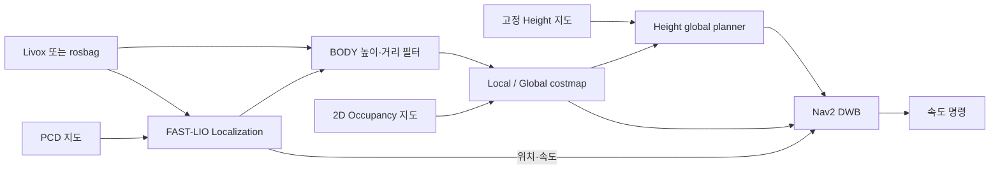

# RUBI Height Navigation

ROS 2 Humble 기반의 LiDAR localization과 높이 지도 기반 navigation workspace입니다. **FAST-LIO Localization**으로 PCD 지도에서 위치를 추정하고, 고정 높이 지도와 실시간 costmap을 함께 사용하는 global planner 및 Nav2 DWB controller를 연결합니다.

- **Localization**: Livox LiDAR/IMU 입력, PCD 정합, RViz 초기 위치 지정.
- **Global planning**: 고정 지형의 높이·통과 가능성·비용을 캐시하고, 최신 global costmap의 장애물을 반영하여 재계획.
- **Local planning**: BODY 원점·중력 방향 높이 필터와 방향별 거리 필터, DWB, FAST-LIO 속도 feedback.
- **Height mapping**: CuPy 기반 높이 지도 생성, 저장, 오프라인 후처리.



[Dependencies](#dependencies) · [Installation](#installation) · [Map assets](#map-assets) · [Live Livox](#live-livox) · [Rosbag replay](#rosbag-replay) · [Configuration](#configuration)

## Dependencies

기준 환경은 **Ubuntu 22.04 / ROS 2 Humble / Python 3.10**입니다. Jetson Orin NX에서 사용하는 실행 구성을 포함합니다.

| 구분 | 필요한 항목 |
|---|---|
| 빌드 | Git, CMake, C++17 지원 컴파일러, colcon, rosdep |
| ROS | Humble, Nav2, RViz2, TF2, PCL ROS 변환, `grid_map_msgs` |
| C++ 라이브러리 | Eigen3, PCL, yaml-cpp |
| Python | NumPy 1.x, SciPy, PyYAML, Matplotlib, Open3D, `tf_transformations`, `ros2-numpy==0.0.5` |
| 센서 | 저장소에 포함된 수정 Livox ROS Driver2 및 Livox SDK2 |
| 높이 지도 **생성 시 추가** | NVIDIA CUDA, CuPy. CUDA 12.x 구성은 CuPy 13.6.0 사용 |

**저장된 높이 지도로 localization/navigation만 실행할 때는 CuPy가 필요 없습니다.** Python 전역 정합에는 Open3D와 `ros2_numpy`가 필요합니다. ROS 의존성 설치, `grid_map_msgs` 소스 빌드 대안, 선택적인 CuPy 환경은 [설치 안내](docs/INSTALL.md)에 정리했습니다.

## Installation

ROS 2 Humble이 설치된 환경에서 시작합니다. 기존 checkout이 있으면 clone을 생략합니다.

```bash
git clone https://github.com/Kimgyoomin/legged_robot_ws.git
cd legged_robot_ws
source /opt/ros/humble/setup.bash
```

1. [설치 안내의 기본 의존성](docs/INSTALL.md#base-dependencies)을 설치합니다.
2. 포함된 Livox SDK2를 workspace 내부 `.sdk`에 빌드합니다.

```bash
cmake -S third_party/Livox-SDK2 -B build/sdk \
  -DCMAKE_BUILD_TYPE=Release \
  -DBUILD_SAMPLES=OFF \
  -DCMAKE_INSTALL_PREFIX="$PWD/.sdk"
cmake --build build/sdk -j2
cmake --install build/sdk
```

3. ROS 패키지를 빌드합니다. `grid_map_msgs`를 로컬 소스로 설치했다면 해당 underlay도 먼저 불러옵니다.

```bash
if [ -f .deps_install/local_setup.bash ]; then
  source .deps_install/local_setup.bash
fi

CMAKE_BUILD_PARALLEL_LEVEL=2 MAKEFLAGS=-j2 \
  colcon build --base-paths src --symlink-install --executor sequential \
  --cmake-args -DCMAKE_BUILD_TYPE=Release -DBUILD_TESTING=OFF

source tools/navigation_env.sh
ros2 pkg prefix fast_lio_localization
ros2 pkg prefix legged_bringup
```

SDK는 시스템 `/usr/local` 대신 `.sdk`를 사용합니다. `archive/`는 기본 빌드에서 제외됩니다. 패키지 역할은 [src/README.md](src/README.md)를 참고하세요.

## Map assets

Localization과 navigation은 같은 `site.yaml`을 사용합니다. 지도 세트에는 다음 파일이 필요합니다.

| 데이터 | 용도 |
|---|---|
| `.pcd` | FAST-LIO 전역 정합 |
| Occupancy `.yaml` + `.pgm` | 2D static costmap |
| `.rghm` | 고정 높이 지도 |
| `site.yaml` | 경로, 좌표계, 해상도, 정합 정보, SHA-256 |

현재 기본 site는 `maps/rubi_1f_height_20261109_wall_gap_v6/site.yaml`입니다. 실제 PCD·PGM·RGHM 및 rosbag은 Git에서 제외되어 있으므로 **clone 후 별도로 준비해야 합니다.** 기본 데이터 배치와 원본/후처리 결과는 [maps/README.md](maps/README.md)에 설명되어 있습니다.

다른 지도를 사용하려면 아래 Localization과 Navigation 명령 **양쪽에** `site:=/absolute/path/site.yaml`을 추가합니다. 지도들이 같은 `map` 좌표계에 정합되어 있어야 하며 시작 시 파일과 해시를 검사합니다. 파일명이나 frame 이름만 바꾸는 것으로 정합을 대신할 수 없습니다.

## Environment

**각 실행 터미널에서** 다음을 실행합니다. 아래 예시는 workspace가 `~/legged_robot_ws`에 있는 경우입니다.

```bash
cd ~/legged_robot_ws
source tools/navigation_env.sh

export ROS_DOMAIN_ID=13
export RMW_IMPLEMENTATION=rmw_fastrtps_cpp
export ROS_LOCALHOST_ONLY=0
```

`navigation_env.sh`는 Humble, 로컬 의존성, 이 workspace의 install 및 Fast DDS 프로필을 불러옵니다. 같은 터미널에 기존 `~/ros2_ws` overlay를 함께 source하지 않습니다.

- 공통 DDS 프로필: participant당 **32 MiB SHM + UDP**. Localization의 큰 PCD publisher는 별도 **128 MiB** 프로필을 사용합니다.
- `dds_profile:=navigation`은 아래 localization/navigation launch의 인자입니다. Livox driver와 bag에는 `navigation_dds with_profile common` wrapper를 사용합니다.
- `taskset` 예시는 8코어 Jetson 기준입니다. 다른 장치에서는 코어 번호를 조정하거나 `taskset -c ...`를 생략합니다. CPU를 독점하는 설정은 아닙니다.
- 센서와 같은 domain에서 bag을 동시에 재생하지 않습니다. 병행해야 하면 **재생용 모든 터미널**을 다른 domain으로 통일합니다.

## Live Livox

**실행 순서: Livox → Localization → 초기 위치·정합 확인 → Navigation → Goal.**

### 1. Livox Driver — 터미널 1

[센서 설정](src/livox_ros_driver2/config/MID360s_config.json)의 IP와 장착 방향을 먼저 확인합니다. 현재 설정은 센서 `192.168.1.145`, 호스트 `192.168.1.5`, X축 기준 180° 회전 장착입니다. 다른 설치에는 해당 값을 맞춰야 합니다.

```bash
ros2 run navigation_dds with_profile common \
  taskset -c 0,1 \
  ros2 launch livox_ros_driver2 rviz_MID360s_launch.py
```

파일명은 **`MID360s`**입니다. 이 launch는 driver와 센서 확인용 RViz를 실행하고, `/livox/lidar`에 **PointCloud2**, `/livox/imu`에 **Imu**를 발행합니다. 이 driver launch에는 `dds_profile` 인자가 없습니다. 센서 확인용 RViz와 아래 localization/navigation용 RViz는 별도 창입니다.

다른 터미널에서 입력을 확인합니다.

```bash
ros2 topic type /livox/lidar
ros2 topic hz /livox/lidar --window 30
ros2 topic hz /livox/imu --window 100
```

현재 설정의 기준 입력률은 LiDAR 약 10 Hz, IMU 약 200 Hz입니다. 장착 회전이 적용된 입력에 별도 axis-flip을 중복 적용하지 않습니다. 방향별 거리·BODY 높이 필터는 이후 navigation에서 적용하므로 이 단계의 센서 토픽은 해당 costmap 필터를 거치지 않습니다.

### 2. FAST-LIO Localization — 터미널 2

```bash
FASTLIO_DIAG_TIMING=1 taskset -c 2,3,4,5 \
  ros2 launch legged_bringup rubi_localization.launch.py \
  input_format:=pointcloud2 \
  dds_profile:=navigation \
  use_sim_time:=false \
  use_rviz:=true
```

이 wrapper는 **`fast_lio_localization/localization_nav_rubi.launch.py`**를 실행하고 site의 PCD를 전달합니다.

1. 센서를 정지한 상태로 초기 IMU 데이터가 들어오도록 기다립니다.
2. Localization RViz의 **2D Pose Estimate**로 PCD 지도 위 실제 위치와 방향을 지정합니다.
3. 현재 점군이 PCD와 맞는지, `/localization`이 들어오는지 확인한 뒤 Navigation을 시작합니다.

Navigation 실행 전에는 같은 RViz의 height/costmap 항목에 `No messages`가 나타날 수 있습니다.

### 3. Height Navigation — 터미널 3

```bash
taskset -c 6,7 \
  ros2 launch legged_bringup rubi_height_navigation.launch.py \
  mode:=nav2 \
  dds_profile:=navigation \
  use_sim_time:=false \
  use_fastlio_velocity:=true \
  cloud_topic:=/livox/lidar \
  rviz:=false
```

PointCloud2를 발행하는 실물 구성에서는 **`cloud_topic:=/livox/lidar`**를 지정합니다. Navigation은 localization을 중복 실행하지 않고 고정 height, map server, costmap, global planner, DWB를 실행합니다.

Nav2 활성화와 **`Frozen terrain READY`**를 확인한 뒤, 이미 열린 Localization RViz의 **Nav2 Goal**로 목표를 지정합니다. 최초 terrain cache 준비에는 시간이 걸리며 이후 요청에서 재사용합니다. 동적 장애물은 local/global costmap으로 계속 갱신합니다.

이 모드의 명령 출력은 `/cmd_vel`입니다. 실제 구동에는 로봇에 맞는 별도 통신 브리지가 필요합니다. 현재 workspace에 `pongbot_lcm`은 포함되지 않으며, `run_lcm_start.sh`는 네트워크 경로 설정 스크립트입니다.

## Rosbag replay

**실행 순서: Localization → 센서 bag + `/clock` → 초기 위치·정합 확인 → Navigation → Goal.** 실물 Livox driver는 실행하지 않습니다.

먼저 형식을 확인합니다. 아래 재생 예시는 기존 `[26.11.06]Height_map_data` bag 기준입니다. 경로는 사용할 bag으로 바꿉니다.

```bash
ros2 bag info "$HOME/rosbag_record/[26.11.06]Height_map_data"
```

| 입력 | 기존 CustomMsg bag | 위 실물 driver에서 녹화한 bag |
|---|---|---|
| `/livox/lidar` | `livox_ros_driver2/msg/CustomMsg` | `sensor_msgs/msg/PointCloud2` |
| `/livox/imu` | `sensor_msgs/msg/Imu` | `sensor_msgs/msg/Imu` |
| Costmap 입력 | `/livox/lidar_pointcloud` — PointCloud2 | `/livox/lidar` — PointCloud2 |
| Localization `input_format` | `custommsg` | `pointcloud2` |

### 1. FAST-LIO Localization — 터미널 1

```bash
FASTLIO_DIAG_TIMING=1 taskset -c 2,3,4,5 \
  ros2 launch legged_bringup rubi_localization.launch.py \
  input_format:=custommsg \
  dds_profile:=navigation \
  use_sim_time:=true \
  use_rviz:=true
```

### 2. 센서 bag 재생 — 터미널 2

```bash
ros2 run navigation_dds with_profile common \
  ros2 bag play "$HOME/rosbag_record/[26.11.06]Height_map_data" \
  --clock 100 \
  --rate 1.0 \
  --read-ahead-queue-size 3000 \
  --start-paused \
  --topics /livox/lidar /livox/imu /livox/lidar_pointcloud
```

1. player 터미널에서 **Space**로 재생하고 초기 5~10초 센서 데이터를 공급합니다.
2. 잠시 일시정지하여 RViz의 **2D Pose Estimate**로 녹화 시작 위치·방향을 지정합니다.
3. 재생을 재개하고 PCD와 점군 정합, `/localization`을 확인합니다.

**`use_sim_time:=true`와 player의 `--clock`은 함께 사용해야 합니다.** 재생 전에는 ROS Time이 0일 수 있고, 일시정지 중에는 센서 입력과 센서에 따른 costmap 갱신이 멈춥니다. 새 localization/navigation을 계산하므로 녹화된 TF, Odometry, costmap, 경로, `/cmd_vel`은 재생하지 않습니다.

### 3. Height Navigation — 터미널 3

```bash
taskset -c 6,7 \
  ros2 launch legged_bringup rubi_height_navigation.launch.py \
  mode:=replay \
  dds_profile:=navigation \
  use_sim_time:=true \
  use_fastlio_velocity:=true \
  cloud_topic:=/livox/lidar_pointcloud \
  rviz:=false
```

`Frozen terrain READY`와 Nav2 활성화 후 같은 RViz에서 **Nav2 Goal**을 지정합니다. `/legged/height`, `/plan`, `/local_plan`, local/global costmap이 함께 표시됩니다. 재생 모드의 명령은 **`/legged/replay/cmd_vel`**로 분리됩니다.

**PointCloud2 bag이라면** 위 Localization의 `input_format:=pointcloud2`, Navigation의 `cloud_topic:=/livox/lidar`로 바꾸고 player에는 `--topics /livox/lidar /livox/imu`를 사용합니다. 두 경우 모두 `/clock`을 생성합니다.

bag의 센서 궤적은 새 속도 명령에 반응하지 않습니다. 이 절차는 녹화 센서에 대한 localization·planning 연동 확인이며 새 경로를 실제로 따라간 결과는 아닙니다. 되감기 전에 localization/navigation도 재시작하여 누적 상태를 초기화합니다. 재생 오류와 확인 명령은 [재생 안내](docs/HEIGHT_REPLAY.md)를 참고하세요.

## Configuration

| 설정 | 위치 |
|---|---|
| LiDAR IP·장착 회전 | [MID360s_config.json](src/livox_ros_driver2/config/MID360s_config.json) |
| PointCloud2 / CustomMsg 전처리 | [mid360s_nav.yaml](src/FAST_LIO_LOCALIZATION2/config/mid360s_nav.yaml) / [rubi_custommsg.yaml](src/FAST_LIO_LOCALIZATION2/config/rubi_custommsg.yaml) |
| DWB·footprint·costmap·BODY 필터 | [nav2.yaml](src/legged_bringup/config/rubi/nav2.yaml) |
| 높이 비용·통과 한도·캐시 | [planner.yaml](src/legged_bringup/config/rubi/planner.yaml) |
| 재계획 주기 | [navigate.xml](src/legged_bringup/config/rubi/navigate.xml) |
| 공통 시각화 | [rubi_height_navigation.rviz](src/legged_bringup/rviz/rubi_height_navigation.rviz) |

현재 기본 구성은 global 재계획 1 Hz, DWB 5 Hz, footprint 0.55 × 0.55 m입니다. `use_fastlio_velocity:=true`는 `/fastlio/odometry_base` feedback과 `LimitedAccelGenerator`를 사용합니다. 높이 planner는 geometry 비용과 0.11 m 통과 한도를 사용합니다. 주기 설정은 실제 처리율 보장을 뜻하지 않습니다.

## Documentation

- [설치 및 선택 의존성](docs/INSTALL.md)
- [Rosbag 재생·표시·문제 확인](docs/HEIGHT_REPLAY.md)
- [지도만 검토하기·실물 전환·지도 교체](docs/HEIGHT_NAVIGATION.md)
- [Frozen planner 캐시 구조·성능 측정](docs/FROZEN_PLANNER.md)
- [지도 생성 및 운영](docs/OPERATIONS.md)
- [시간과 메시지 형식](docs/TIMING.md)
- [패키지 구조](src/README.md) · [지도 세트](maps/README.md) · [도구](tools/README.md)

## License and acknowledgements

FAST-LIO Localization, Livox ROS Driver2/SDK2, CuPy elevation mapping 및 Nav2를 기반으로 합니다. 구성요소별 출처와 라이선스는 [THIRD_PARTY.md](docs/THIRD_PARTY.md) 및 각 패키지의 LICENSE를 참고하세요.
