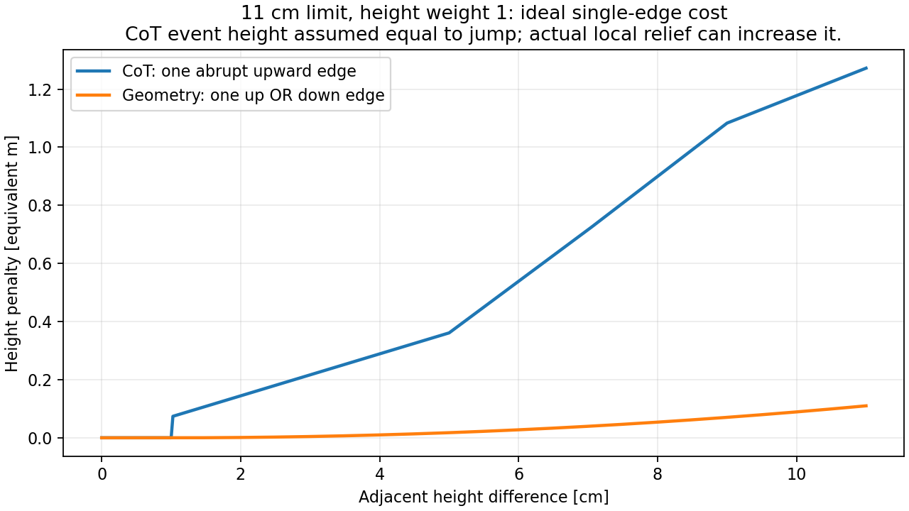
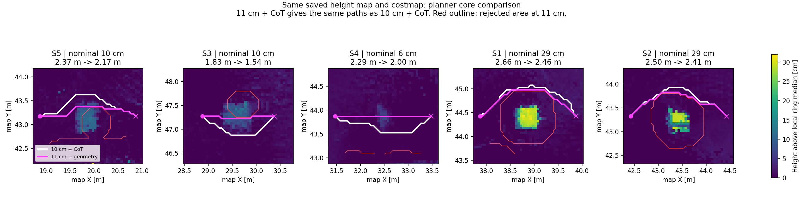

> 2026-11-09 초기 연결/지도 비교 기록. 현재 실행 방법과 RUBI 설정은 [HEIGHT_REPLAY](../../../../docs/HEIGHT_REPLAY.md)와 [HEIGHT_NAVIGATION](../../../../docs/HEIGHT_NAVIGATION.md)을 따른다. 이 문서의 generic 설정은 현재 RUBI profile과 다르다.

# RUBI 실물 height map → Nav2 연결 (2026-11-09)

## 이번 연결

- 원본: `maps/raw/run_1794037249460292244/map.rghm` (map, 5cm, usable 258,096 cells).
- 선택 manifest: `maps/rubi_1f_height_20261107/site.yaml`.
- 기존 RUBI PCD와 2D occupancy 파일을 참조한다. 원본 지도/point cloud 및 navigation_real 코드는 변경하지 않는다.
- `frozen_map -> /legged/height -> legged_navigation/HeightPlanner -> /plan`.
- 전체 Nav2 모드에서는 DWB/RPP → `/legged/cmd_raw` → collision_monitor → `/legged/cmd_safe` → command_watchdog → `/cmd_vel`.
- frozen height map은 CPU만 사용하며 mapping 노드나 CuPy는 필요 없다.
- 높이, unknown mask, 관측 시각은 보존한다. 이번 작업에서는 구멍을 메우거나 단차를 삭제하지 않았다.

## 지도와 경로를 먼저 보기

새 터미널에서:

```bash
cd ~/legged_robot_ws
source tools/navigation_env.sh
export ROS_DOMAIN_ID=186
export ROS_LOCALHOST_ONLY=1
ros2 launch legged_bringup rubi_height_navigation.launch.py mode:=review
```

RViz에서 `2D Pose Estimate`로 경로의 시작점을 정하고 `2D Goal Pose`로 목적지를 정한다.
여기서 Pose Estimate는 실제 로봇의 초기화를 뜻하지 않는다. review 전용 도메인에서 선택한 시작점이다.
`/legged/review_path`에 노란 경로가 표시된다. review에는 controller, LCM, 센서 드라이버, 가짜 로봇 TF가 없으며 `/cmd_vel`을 발행하지 않는다.
리뷰 중 live 시스템과 같은 ROS 도메인을 쓰지 않는다. `/map`, `/initialpose`, planner_server 이름이 같기 때문이다.

검증된 시작·목표 예시(map 좌표):
- 복도: (18.975, 42.975) → (22.975, 42.975)
- 단차 주변: (27.975, 43.975) → (37.975, 44.025)

## 전체 Nav2와 연결

같은 manifest를 그대로 사용한다. 실제 localization이 `map -> camera_init -> body -> base_link`를 제공하고,
PointCloud2 및 Odometry 입력이 준비된 별도 터미널에서:

```bash
cd ~/legged_robot_ws
source tools/navigation_env.sh
export ROS_DOMAIN_ID=13
export ROS_LOCALHOST_ONLY=0
ros2 launch legged_bringup rubi_height_navigation.launch.py \
  mode:=nav2 controller:=dwb use_sim_time:=false \
  cloud_topic:=/livox/lidar odom_topic:=/Odometry
```

`legged_robot_ws`의 MID-360S driver는 `/livox/lidar`를 PointCloud2로 사용하는 구성이며,
기존 navigation_real driver를 사용할 경우 PointCloud2인 `/livox/lidar_pointcloud`를 지정한다.
CustomMsg를 Nav2 점군 입력에 넣으면 안 된다. `ros2 topic type`으로 확인한다.
controller:=rpp를 선택하면 동일 HeightPlanner와 Nav2 costmap에서 RPP로 바뀐다.

이 명령은 legged_robot_ws의 기존 Nav2 설정을 사용한다. navigation_real의 BODY/중력 높이 필터,
최신 외부 장착 TF, LimitedAccelGenerator, 전용 velocity feedback 설정을 자동으로 가져오지 않는다.
현재 DWB는 10Hz, 최대 전진 0.3m/s, 가속 0.5m/s², StandardTrajectoryGenerator이며
collision stop 영역은 1.0×0.9m이다. 실제 로봇용 설정의 최종 이식/검증은 별도다.
`/Odometry` twist가 실제로 채워지는지도 확인해야 한다. 지도 연결 시험을 실물 주행 검증으로 해석하지 않는다.
LCM 노드는 이 launch가 실행하지 않는다.

## 후처리한 지도 교체

원본 manifest와 원본 지도는 남기고 새 manifest를 만든다:

```bash
cd ~/legged_robot_ws
source tools/navigation_env.sh
python3 tools/replace_site_height.py \
  --site maps/rubi_1f_height_20261107/site.yaml \
  --height /절대경로/후처리한/map.rghm \
  --output maps/rubi_1f_height_20261107/site_processed_v2.yaml
```

그다음 launch에 `site:=/home/rclab/legged_robot_ws/maps/rubi_1f_height_20261107/site_processed_v2.yaml`을 전달한다.
실행 중 파일만 덮어쓰면 기존 frozen_map이 자동 갱신되지는 않는다. 해당 실행을 종료하고 다시 실행한다.
map frame, resolution, origin, dimensions가 달라지면 도구가 거부한다. 좌표계 변경 시에는 정합을 다시 해야 한다.
geometry가 같다는 검사는 공간 정합 품질이나 로봇의 통과 가능성까지 보증하지 않는다.
입력은 RGHM이다. 시각화용 PCD나 inferred fills가 섞인 preview를 무작정 대체하지 않는다.

## DDS·빌드

`navigation_env.sh`와 전용 launch는 기존 navigation_real과 같은 32MiB SHM+UDP,
TX/RX 4MiB 요청 XML을 사용한다. 시스템 sysctl이나 apt는 수정하지 않는다.
큰 `/cloud_pcd`를 발행하는 localization 프로세스의 DDS profile은 별도로 유지한다.
이 환경 스크립트는 frozen map/Nav2용이며 CuPy 환경을 요구하지 않는다.

```bash
source /opt/ros/humble/setup.bash
source ~/legged_robot_ws/.deps_install/local_setup.bash
source ~/legged_robot_ws/install/local_setup.bash
cd ~/legged_robot_ws
CMAKE_BUILD_PARALLEL_LEVEL=2 colcon build --symlink-install --executor sequential \
  --packages-select rubi_heightmap_step_wavefront_planner legged_navigation legged_bringup \
  --packages-ignore fast_lio genz_icp \
  --cmake-args -DCMAKE_BUILD_TYPE=Release -DBUILD_TESTING=ON
```

`fast_lio`와 `genz_icp`는 이 연결에서 사용하지 않는 대체 localization 패키지이며 현재 미설치다.
선택 빌드에서만 제외한다. 기존 fast_lio_localization 설치는 유지한다.

## 검증 결과와 한계

`validation/height_navigation_20261109/`에 실행 로그, 원본 지도 경로 결과, 그림을 저장했다.
- 실제 지도 + 실제 Nav2 HeightPlanner: 4m 복도 82 poses, 10m 주변 구간 201 poses 생성.
- 동일 원본 지도에 가상 TF/점군/Odometry를 넣은 DWB 전체 흐름: 경로 생성,
  비영 명령 출력, 장애물 추가 시 우회, 근접 점군 및 센서 중단 시 정지 확인.
- 정지 가상 로봇이라 목표 도달, 실제 보행/단차 통과, LCM 전달은 검증하지 않았다.
- 가상 Navigation goal 취소 순간 BT의 FollowPath result timeout 로그 1회가 있었다.
  이후 cancel 수신과 프로세스 종료를 확인했다. 센서 중단 단계의 stale 경고는 의도한 시험이다.
- review는 static occupancy + inflation만 사용한다. 실제 동적 장애물은 전체 Nav2 모드에서 입력한다.
- planner 최대 단차 0.10m, local relief 0.10m, terrain clearance 0.20m,
  costmap clearance 0.45m 설정은 변경하지 않았다. 29cm 단차를 자동으로 넘어가는 설정이 아니다.
- 원본의 큰 빈 영역은 남는다. 그곳으로 목표를 찍거나 통과를 요구하면 경로 실패가 정상일 수 있다.
- 정합은 기존 localization의 map 좌표와 사전 PCD 비교를 근거로 유지했다.
  과거 구조물 비교의 XY 중앙 오차 약 2.5cm와 위치별 차이가 있으며 측량/현장 검증은 아니다.

## 2026년 11월 9일 3D 보기와 높이 비용 비교

현재 실제 실행용 `config/planner.yaml`은 CoT 비용과 10cm 한도를 유지한다. 이번에 추가한 옵션은 **mode=review에만** 적용된다. 저장 지도 자체는 바꾸지 않았다. 시작 방 보정 v2를 사용한 11cm·기하 높이 비용 비교는 아래처럼 실행한다. 같은 domain의 이전 review launch를 종료한 뒤 실행한다.

```bash
cd ~/legged_robot_ws
source tools/navigation_env.sh
export ROS_DOMAIN_ID=186
export ROS_LOCALHOST_ONLY=1
ros2 launch legged_bringup rubi_height_navigation.launch.py \
  mode:=review \
  site:="$PWD/maps/rubi_1f_height_20261109_startfloor_v2/site.yaml" \
  review_planning_time_ms:=5000 \
  review_height_limit_m:=0.11 \
  review_height_cost:=geometry
```

- `review_height_cost:=configured`: planner.yaml의 선택을 그대로 사용한다. 기본값이다.
- `review_height_cost:=cot`: CoT 표 기반 비용을 사용한다.
- `review_height_cost:=geometry`: 기존 C++ 코드의 인접 셀 높이 차이 비용을 사용한다.
- `review_height_limit_m:=0.11`: 인접 높이 차이 한도와 local relief 한도를 함께 11cm로 바꾼다. 생략하면 기존 값을 유지한다.
- `review_planning_time_ms:=5000`: 오프라인 검토용 탐색 제한이다. 실제 주행의 계획 예산을 바꾸지 않는다.

`mode=nav2`에서는 이 review 옵션들을 읽기 전에 기존 navigation launch로 분기한다. 실제 납품 설정으로 채택하려면 별도로 planner.yaml을 확정하고 실제 controller·충돌 검사와 검증해야 한다.

### 3D 조작

RViz 기본 시점을 `TopDownOrtho`에서 `Orbit`으로 바꾸고 Views 패널을 추가했다. 이미 열린 창은 설정 파일 수정만으로 바뀌지 않는다. 현재 창에서는 `Panels → Views`를 열고 Type을 `Orbit`으로 선택하면 된다.

`Move Camera` 도구에서 왼쪽 드래그는 회전, 가운데 드래그는 이동, 휠은 확대·축소다. 2D Pose Estimate/Goal 도구를 선택 중이면 먼저 Move Camera로 돌아온다. `Focus Camera` 도구로 관심 위치를 선택하거나 마우스를 물체에 놓고 F로 초점을 맞출 수 있다. 저장한 `2D plan view`로 돌아가면 평면 경로를 비교할 수 있다. 조작 근거: [공식 RViz 문서](https://github.com/ros2/rviz/blob/rolling/rviz2/doc/index.rst).

`Occupancy`는 기본 표시를 껐다. 2D 평면이 음수 Z에 있는 바닥 점군을 가릴 수 있기 때문이다. 필요하면 체크해서 겹쳐 본다. 높이 점군 Alpha는 1.0으로 했으며, 높이를 시각적으로 과장하거나 지도 값을 바꾸지 않았다. 전체 수십 m 지도를 볼 때 6~29cm 단차가 작게 보이므로 확대해서 비스듬히 확인한다.

### 실제 비용 계산

현재 `planner_run_mode=grid_only`의 계산은 `src/rubi_heightmap_step_wavefront_planner/src/step_evaluator.cpp`의 `evaluateGridTransition()`에 있다. 높이 지도의 절대 Z가 아니라 **이동 전후 인접 셀의 높이 차이**를 사용한다. 지도 전체의 Z 원점을 옮겨도 이 차이는 같다.

통과 가능성을 먼저 판정한 뒤, 유효한 이동에 다음 비용을 더한다.

```text
edge_cost = 1.0 × 이동거리
          + 5.0 × (도착 셀의 costmap 값 / 252) × 이동거리
          + 1.0 × 높이 비용
          + 0.0 × Sobel 경사 비용
path_cost = 모든 이동 edge_cost의 합
```

lethal/unknown, 높이 증거 부족, 단차 한도 초과 등은 단순히 큰 비용을 주는 대신 통과를 거부할 수 있다. `costmap_clearance_m=0.45`와 `grid_terrain_clearance_distance_m=0.20`도 비용 가중치와 별개의 제약이다. CoT를 꺼도 이 제약은 그대로다.

**기존 CoT 방식**

```text
d = 도착 셀 높이 - 출발 셀 높이
E = max(abs(d), 해당 이동에서 확인한 주변 raw local relief)
상승 중(d > 0)이고 E > 0.01m이면:
    height_cost = P(E) × clamp(d/E, 0, 1)
그 외에는 height_cost = 0
```

P는 다음 표의 선형 보간값이다. 범위 밖은 끝값으로 제한된다. 이것은 지도 전체의 높이에 비용을 주는 방식이나 실시간 전력 측정값이 아니다. 설정 주석도 RUBI 실험에서 가져온 표이며 범용 로봇 보정값이 아니라고 명시한다. 하강 방향 높이 비용은 0이지만 하강의 통과 제한까지 해제되는 것은 아니다.

| E (cm) | 0 | 5 | 7 | 9 | 11 | 13 | 15 |
|---|---:|---:|---:|---:|---:|---:|---:|
| P(E), 등가 거리 벌점 (m) | 0 | 0.361 | 0.716 | 1.083 | 1.272 | 1.604 | 1.634 |

**기하 높이 방식**

`grid_cot_height_cost_enabled=false`인 기존 분기를 사용한다. H는 최대 높이 차이 한도, n은 noise floor다.

```text
jump = abs(도착 셀 높이 - 출발 셀 높이)
jump > H이면 통과 거부
jump <= n이면 height_cost = 0
그 외: height_cost = H × ((jump - n) / (H - n))^2
이번 비교: H=0.11m, n=0.01m
```

상승·하강에 대칭적으로 적용한다. 예를 들어 이상적인 한 edge에 6cm 높이 변화가 전부 있으면 비용은 0.0275m다. 6cm를 올라갔다 내려오면 이 두 변화의 합은 0.055m다. 실제 지도에서는 경계가 여러 셀에 분산되어 실제 합이 달라진다.



**주변 높이 변화 제한(local relief)**은 비용과 별도로 남는다. 첫 반경 0.1m에서 높이 P90−P10을 구하고, 두 번째 반경 0.1m에서 이를 모은다. 이웃 중 임계값 초과 개수/3을 최대 1로 제한한 지지 비율과 최대 raw relief를 곱한다. 이 supported relief가 한도보다 높으면 거부한다. 관측 비율 조건은 0.7이다. 따라서 물체 윗면의 중앙 높이가 10cm라고 모든 가장자리가 11cm 검사를 통과하는 것은 아니다.

### 저장 지도와 실제 Nav2 비교 결과

동일한 v2 지도, 실제 Nav2에서 얻은 costmap snapshot, 동일하게 컴파일된 planner core로 3가지 설정을 비교했다. 아래 길이는 각 단차 주변의 동일 시작·목표 쌍에서 얻은 경로 길이다.

| 단차 | 지도 측정 윗면 중앙값 | 10cm + CoT | 11cm + CoT | 11cm + 기하 높이 |
|---|---:|---:|---:|---:|
| S5, (19.83,43.16), 실제 10cm | 10.69cm | 2.373m | 2.373m | 2.166m |
| S3, (29.60,47.25), 실제 10cm | 9.17cm | 1.831m | 1.831m | 1.541m |
| S4, (32.48,43.82), 실제 6cm | 5.75cm | 2.290m | 2.290m | **2.000m 직선** |
| S1, (38.82,44.37), 실제 29cm | 28.88cm | 2.656m | 2.656m | 2.456m 우회 |
| S2, (43.45,43.24), 실제 29cm | 29.33cm | 2.497m | 2.497m | 2.414m 우회 |

11cm로 한도만 늘린 경우 이 다섯 경로는 바뀌지 않았다. 두 10cm 단차의 검사한 중심 횡단 구간에는 여전히 통과 제한 edge가 남았다. 주변 높이 변화가 약 11.86cm/12.07cm인 부분과 20cm 지형 여유 거리의 영향이다. 기하 비용에서 더 가까이 지나가는 경로가 생겼다는 것이 모든 윗면을 통과할 수 있다는 뜻은 아니다.



흰색은 기존 10cm+CoT, 자홍색은 11cm+기하 비용이다. 빨간 윤곽은 11cm 설정의 거부 영역이다. 배경 높이는 시각화용 주변 고리 중앙 높이 대비이며, 윗면 측정값은 별도 국소 평면 fitting 결과다.

설치된 launch와 실제 Nav2 action도 격리한 domain 187에서 검증했다. 실행 파라미터가 CoT=false, jump=0.11, relief=0.11임을 조회했고, 다섯 ComputePathToPose 요청 모두 SUCCEEDED였다. 이는 **우회를 포함한 경로 생성 성공**이다. S4는 길이 2.000m, Y 일정인 직선 경로였다. S1/S2는 Y가 약 0.6m/0.55m 변하는 우회였다. 실제 action 입력 좌표와 core probe의 셀 중심이 일부 수 cm 달라 경로 길이는 조금 다르다. domain에 `/cmd_vel` 등 주행 명령 토픽이 없음을 검사하고 시험 프로세스를 종료했다.

검증 자료: `validation/height_cost_review_20261109/`의 probe JSON 3개, summary.json, runtime 로그/경로, 재현 스크립트. 실제 동작 검증은 planner-only이며 단차 보행 성공이나 500ms 주행 계획 예산 충족을 뜻하지 않는다.

### 출입구 흔적과 납품 설정에서 남은 판단

시작 방 `(2.64,0.12)` 주변은 별도 v2에서 빈 셀 125개와 사람/이동 물체로 확인된 후보 관측 625개를 보정했다. 이번 비용 비교에서는 지도 값을 더 바꾸지 않았다. 남은 출입구 형상을 전부 발로 간주하면 기둥·문틀까지 지울 수 있다. 사용자가 대상 영역을 확인하면 기존 PCD 바닥 지지점과 occupancy 자유 공간 조건을 이용해 추가 보정할 수 있으며, 전부 수작업으로 셀을 지울 필요는 없다.

이전 출입구 진단에서는 높이 제한을 빼도 기존 occupancy와 45cm costmap clearance가 방→복도 연결을 끊었다. 발 흔적 제거만으로 이 제약이 사라지지는 않는다. 몸체 크기를 근거로 여유 거리와 출입구 실제 폭을 따로 확인해야 한다.

납품용 기본 비용으로는 기하 방식이 설명하기 쉽고 현재 로봇의 CoT 표 보정에 의존하지 않는다. 다만 현재 구현에는 다음 특성이 있다.

- **절대 높이가 아닌 상대 높이 차이 비용**이다. 높은 층에 있다는 이유만으로 평지를 비싸게 만들지 않는다.
- 제곱 비용과 1cm deadband는 셀 간 경계가 얼마나 퍼졌는지에 영향을 받는다. 완만한 경사에서 셀별 변화가 1cm 이하이면 이 높이 비용은 0일 수 있다. 현재 Sobel 경사 비용 가중치도 0이다. 따라서 이를 경사·거칠기까지 검증된 종합 지형 비용이라고 설명하면 안 된다.
- H는 통과 한도이면서 비용 정규화에도 쓰인다. 10→11cm 변경은 통과 판정뿐 아니라 같은 jump의 비용도 바꾼다. 납품 파라미터를 확정할 때 이를 명시하거나 추후 두 척도를 분리할 수 있다.
- height cost 가중치 1은 경로 선호 조절값이며 실물 에너지, 충격 또는 보행 성공률이 아니다. 낮추면 통과 가능한 단차를 더 선호하지만 통과 불가 제약은 유지된다.
- 이번 변경은 기존 비용 분기를 선택하고 RViz/launch를 수정한 것이다. 실시간 SLAM 연산을 추가하지 않았다. planner 전체 부하가 감소한다는 하드웨어 비교 측정은 하지 않았다.

우선 이 review 명령으로 6cm 통과와 29cm 우회를 확인하고, 10cm 경계의 측정 분포·보행 허용치를 확인한 뒤 한도를 확정한다. 통과를 시키기 위해 실제 단차 높이를 지도에서 낮추지는 않는다.


## 2026-11-09: v3 단차 보존 + v4 바닥 결손 보완

현재 검토 후보는 `maps/rubi_1f_height_20261109_floorcomplete_v4/site.yaml`입니다. v3의 기존 셀과 10/10/6/29/29 cm 단차를 유지하고, 원래 관측 바닥·높이 편차를 보정한 PCD·2D free 영역을 대조해 1,236개 미관측 셀(3.09 m²)을 추가했습니다. 추론 셀은 `provenance.npz`의 `v4_filled`에 기록됩니다. 자세한 전후 그림·조건·제약은 [v4 보고서](../../maps/rubi_1f_height_20261109_floorcomplete_v4/REPORT.md)에 있습니다.

```bash
cd ~/legged_robot_ws
source tools/navigation_env.sh
export ROS_DOMAIN_ID=186
export ROS_LOCALHOST_ONLY=1
ros2 launch legged_bringup rubi_height_navigation.launch.py \
  mode:=review \
  site:="$PWD/maps/rubi_1f_height_20261109_floorcomplete_v4/site.yaml" \
  review_planning_time_ms:=5000 \
  review_height_limit_m:=0.11 \
  review_height_cost:=geometry
```

기존 같은 domain의 review 실행을 종료하고 새 후보를 엽니다. `site`를 명시하므로 기존 기본 지도/주행 설정은 바뀌지 않습니다. review의 11 cm/geometry 설정은 실차 `mode:=nav2`에 자동 적용되지 않습니다. 실제 2D 지도 장애물로 남아 있는 부분은 height 보간만으로 통과 가능해지지 않습니다.

패키지 역할·설정 파일 위치는 [src 안내](../../../../src/README.md)를 참조합니다.
