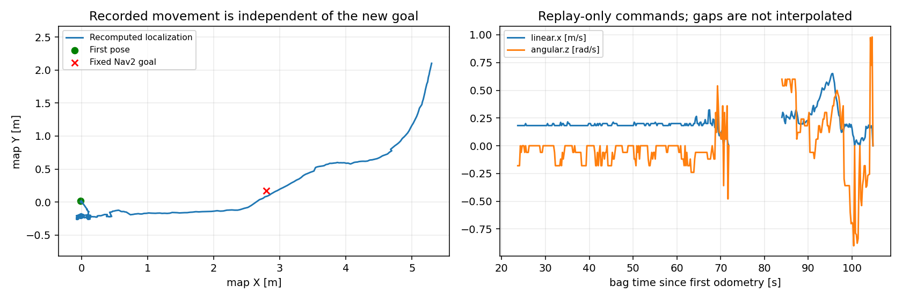
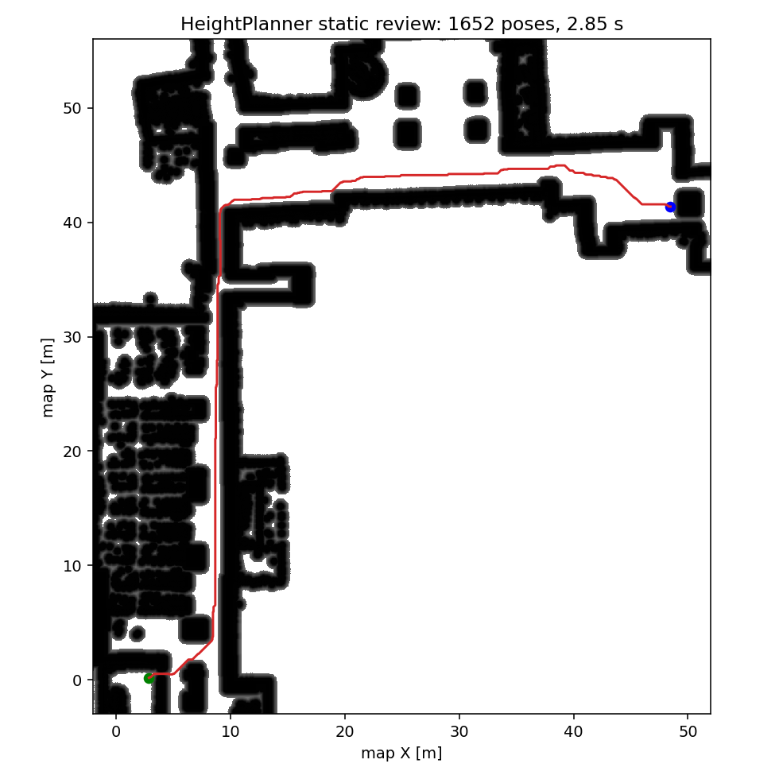

# RUBI raw-bag integration verification — 2026-11-09

## Scope and evidence

Source baseline: navigation_real commit `9678c7a80da53f3fa214395ce4af792e37fa832f`, including current working YAML. Per-file source hashes: `src/legged_bringup/config/rubi/baseline_sources.json`. Only legged_robot_ws was changed. Existing navigation_real worktree remained with its pre-existing `FAST_LIO_LOCALIZATION2/config/mid360.yaml` modification.

Bag: `/home/rclab/rosbag_record/[26.11.06]Height_map_data`. Only `/livox/lidar` (CustomMsg), `/livox/imu`, and `/livox/lidar_pointcloud` were replayed. All localization/TF/plan/costmap/command outputs were recomputed. No bag TF/old command output was reused.

Domain 188, Fast DDS common/large profiles, ROS_LOCALHOST_ONLY=0, RViz disabled, **no CPU affinity pinning**. No LCM, live sensor driver or robot interface was launched. The only command topic was `/legged/replay/cmd_vel`. Navigation goal `(2.8,0.17)` was submitted only to this isolated graph. Initial pose `(0,0,0)` was provided after IMU initialization. The replay is open-loop, not closed-loop robot control.

## Build and automated checks

- Release builds completed for navigation_dds, fast_lio_localization, legged_navigation, legged_bringup. `MAKEFLAGS=-j2`, sequential packages.
- `tests.log`: selected FAST-LIO/navigation/bringup tests passed (velocity math, point timing, height/sector filter, existing pursuit/launch contracts).
- `final_pytest.log`: 21 tests passed for DDS profile scoping, standalone input formats, and RUBI profile/replay allowlist. Initially copied DDS tests referenced absent pongbot packages; those contracts were adapted to actual legged launch graphs and rerun.
- `final_fastlio_tests.log`: 3 C++ test binaries passed, 11 cases total.
- `git diff --check` clean. Site PCD, occupancy YAML/image and RGHM SHA256 all still match the V6 manifest. Maps were not edited by this integration.

## Raw replay at 1.0x

The final run received 1,080 odometry messages over about 108 bag seconds. Recomputed XY extent was 5.37m × 2.37m, so the run includes recorded movement. It does not cover the whole 1,044-second bag or the distant corridor.

Rates below use **received wall-clock intervals**, excluding startup (probe wall time <25s). A median stamp interval is not equivalent to an average delivered rate.

| Output | Samples total | Mean wall rate | Maximum received gap |
|---|---:|---:|---:|
| `/Odometry` | 1080 | 10.000 Hz | 0.116 s |
| `/localization` | 1080 | 9.999 Hz | 0.122 s |
| `/fastlio/odometry_base` | 1080 | 10.000 Hz | 0.119 s |
| `/livox/lidar_costmap` | 539 | 5.000 Hz | 0.222 s |
| `/local_costmap/costmap` | 389 | 3.638 Hz | 0.404 s |
| `/global_costmap/costmap` | 92 | 0.863 Hz | 2.038 s |
| `/map_to_odom` | 53 | 0.500 Hz | 2.015 s |
| `/plan` | 38 | 0.477 Hz | 14.598 s |
| `/local_plan` | 346 | 4.264 Hz | 12.104 s |
| `/legged/replay/cmd_vel` | 348 | 4.279 Hz | 11.916 s |

- Controller, planner and BT navigator reported `active`; goal was accepted. 344 nonzero replay commands were received. Controller parameters queried by service: DWB 5Hz, `/fastlio/odometry_base`, LimitedAccelGenerator, sim_period=0.2s, use_sim_time=true.
- Localization age against replay `/clock`: median 6.9ms, maximum 35.9ms. This is a replay-pipeline measurement with a 100Hz clock, not physical sensor-to-actuator latency.
- Filtered pointcloud age median about 105ms includes the scan's start timestamp and ~100ms scan accumulation; it is not directly comparable with scan-end odometry age.
- Local/global costmap configurations are update/publish 5/5Hz and 1/1Hz. Actual delivered means were **3.64Hz and 0.86Hz**, although median stamp intervals were 0.2s and 1s. This test did not instrument the internal costmap update loop, so neither an internal 5Hz guarantee nor a CPU-bottleneck conclusion is justified.
- The recorded trajectory moved past and away from the fixed test goal; this can affect planning and recovery, but the precise cause of each failure was not isolated. HeightPlanner reported intermittent `grid path not found`, BT cleared costmaps/waited/retried, and local-plan/command output had ~12s gaps. Successful output followed again. The run demonstrates connected components; it is not an uninterrupted goal-reaching demonstration. Dynamic obstacle evidence and height constraints remain active.
- No bag read-ahead starvation warning was observed during this short run. Initial TF buffer clock-switch notices and a startup height-filter drop occurred.
- Cancel during a pending plan produced one BT halt/result timeout message. All launch children then exited cleanly. The test's outer bag wrapper required process-group TERM during cleanup (not a data-stream failure).
- The first exploratory run exposed a null `FILE*` close during FAST-LIO shutdown when its optional Log directory was absent. File close/write guards and Python clean shutdown were applied; the final run has no node crash/segfault.

## Previously failing full static route

Domain 187, review only, no controller. Exact start `(2.85944,0.169367)` and goal `(48.4538,41.392)`, V6 site, 11cm height limit, geometry cost, 5,000ms search budget, 0.30m center clearance. Actual Nav2 result status 4 (success), **1,652 poses, 2.845s wall time**. No command topics were present. Files: `full_route/`.

Earlier 0.45m clearance disconnected the ~0.8m start-room doorway. The 0.30m setting preserves that connection. Center clearance is not full rotating-footprint collision proof; DWB separately uses the 0.55m square footprint.

## Remaining delivery checks

1. Replay the entire bag and set a goal consistent with its recorded route; show localization alignment, both costmaps, height plan and DWB output. Do not claim the new commands drove the recorded robot.
2. Record video with RViz enabled and the intended CPU affinity. Those display/CPU-load conditions were not exercised in this headless run.
3. A 2.85s long-route plan cannot sustain 1Hz replanning; 1Hz is a BT request target. Optimize/cache or explicitly choose a slower global planning policy before promising live performance. This integration intentionally retained the planner core.
4. Review dynamic obstacle classification over 6/10cm steps. Even a height-traversable step can still be blocked by the dynamic obstacle layer and DWB footprint. No artificial clearing of those observations was added.
5. Validate goal cancellation/recovery behavior for the delivery scenario. No actual step traversal or LCM reception was tested.
