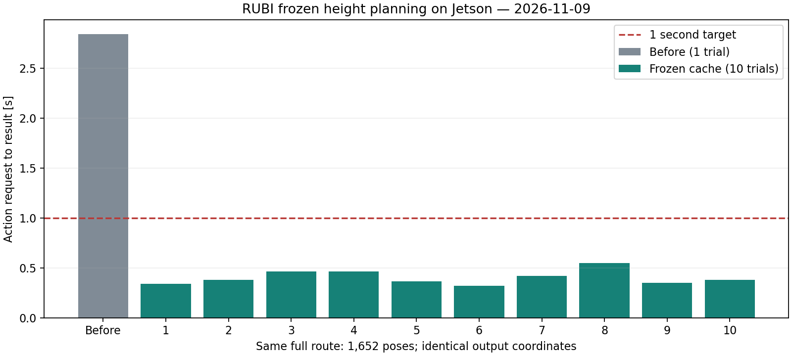

# Frozen height planner 최적화와 파일 구조

2026-11-09 · 대상: `legged_robot_ws`, Jetson에서 Release 빌드.

## 결과

현재 최종 높이 지도와 기존 전체 경로에서 **캐시 준비 후 계획 요청→결과 수신 0.322~0.550초, 중앙값 0.381초(10/10 성공)**를 확인했다. 이전 실제 Nav2 요청 기록은 2.845초(1회)다. 기존과 새 costmap 바이트가 같고, 1,652개 경로 좌표 x/y/z가 모두 정확히 같았다. 이번 시험에서 1초 이내 계산 목표를 달성했지만 모든 지도·부하에서의 실시간 보장은 아니다.



| 측정 구간 | 이전 | 변경 후 |
|---|---:|---:|
| 실제 전체 경로 action 왕복 | 2.845초, 1회 | 0.322~0.550초, 10회 |
| 새 planner 내부 total | — | 221.4~342.7ms |
| 고정 지도 준비 | 요청마다 반복 | 시작/지도 교체 때 한 번, 약5~11초 |
| 동일 경로 poses | 1,652 | 1,652, 좌표 완전 일치 |
| 동일 경로 탐색 expansions | 82,226 | 82,226 |
| 코어 프로파일 경로 비용 | 102.689 | 102.689 |

이전/이후는 같은 장치의 별도 실행이며 부하를 고정한 paired benchmark는 아니다. 사용자가 켜둔 기존 ROS/RViz를 종료하지 않았고, 최적화된 측정 노드의 RViz는 껐다. 서버 `total`은 snapshot+clearance+search/finalization까지, action 왕복은 DDS·요청 처리·결과 전달까지 포함한다. 처음 5초는 매번 기다리도록 둔 지연이 아니라 탐색의 기존 시간 상한이었다.

## 병목과 변경 원리

기존 코어 측정에서 요청마다 terrain hazard 계산 603~837ms, 탐색 3,357~3,424ms가 소요됐다. 전체 costmap 격자에 대한 큰 임시 노드 저장소, 반복적인 높이 근거 조회와 relief/edge 평가, 탐색한 모든 노드·edge의 결과 객체 구성이 비용을 만들었다. hazard만 재사용하거나 기존 evaluator만 재사용해도 3~4초대여서 충분하지 않았다.

`FrozenGridCache`가 다음을 고정 문맥으로 저장한다.

1. 높이 snapshot과 지도 geometry, 높이 평가 파라미터.
2. 셀별 높이 근거·관측 여부·relief·terrain clearance 판정.
3. 이웃 8방향의 지형 통과 여부와 비용. 오르막/내리막 비용이 다를 수 있어 방향별로 저장한다.
4. 조밀한 셀→저장소 index와 필요한 평가 결과. 매 요청 전체 거대 optional 배열을 만들지 않는다.

매 요청에는 **현재 costmap의 장애물·unknown·inflation·occupancy clearance**를 다시 적용하고 A*를 수행한다. 이미 계산된 최종 경로를 무조건 되돌려주는 방식이 아니다. 따라서 신규 장애물, 장애물 제거, 시작·목표 변경을 반영한다. 탐색 전체 그래프의 복제 대신 최종 경로만 결과로 구성하고 원래 evaluator로 경로 metrics를 계산한다. 이 때문에 cached 모드의 탐색 전체 rejection/debug graph 상세는 uncached 모드와 동일하게 제공되지 않는다.

```text
고정 높이 지도 + geometry + 지형 파라미터
                 ↓ 변경 시 background 준비
           FrozenGridCache (재사용)
                 +
   매 요청 최신 costmap + start/goal
                 ↓
    동적 장애물 검사 + A* → Nav2 Path
```

## 언제 다시 계산하는가

| 변경 | 동작 |
|---|---|
| 시작/목표만 변경 | terrain cache 유지, 새 A* |
| 동적 장애물/inflation/unknown 갱신 | terrain cache 유지, 최신 costmap 검사 |
| 높이 데이터 내용 변경 | 새 snapshot, 기존 준비 결과 무효화, background 재계산 |
| 지도 크기·해상도·원점 변경 | geometry 변경 감지, 재계산 |
| 높이/clearance/비용 파라미터 변경 | 명시적 재설정 후 재계산 |

높이 지도는 TRANSIENT_LOCAL로 한 번 발행한다. 경로 요청 때 전체 지도 hash나 높이 이웃을 재검사하지 않는다. 별도 500ms 준비 timer는 **snapshot 포인터와 geometry의 다섯 스칼라**만 비교한다. 높이 메시지가 실제로 도착할 때만 decode/content hash를 계산한다. 같은 데이터 재발행은 새 캐시를 만들지 않는다.

현재 `Height.*` ROS 파라미터의 실행 중 변경은 명시적으로 거절한다. YAML/launch 값을 바꾸고 navigation을 재시작하는 것이 지원되는 경로다. lifecycle cleanup→재설정→configure도 캐시를 다시 만든다. `ros2 param set`만 성공해 보이면서 옛 캐시가 유지되는 상황을 막는다. `cache_frozen_terrain:=false`에 해당하는 plugin YAML 설정으로 원래 경로를 사용할 수 있다.

시작 시 `Frozen terrain preparing` 후 `Frozen terrain READY`를 기다려야 한다. 준비 중 계획 요청은 준비 중이라는 오류를 반환한다. 정적 높이와 현재 costmap geometry가 맞지 않으면 오래된 캐시로 진행하지 않는다.

## 시간·메모리

현재 RUBI 설정의 탐색 시간 예산은 **800ms**다. 이것은 전체 action 800ms를 보장하는 hard deadline이 아니며, costmap 복사/clearance/결과 전달은 추가된다. 더 큰 지도·다른 목표·강한 부하에서는 실패나 1초 초과가 가능하다.

최종 지도에서 준비된 노드는 308,570개, 직접 계수한 cache index/평가 저장소는 115,682,840바이트(110.3MiB)다. 이는 auxiliary evaluator/hazard 및 ROS 메모리를 제외한다. 별도 코어 프로세스의 최대 RSS는 **319,268KiB(약312MiB)**였다. ROS 전체·RViz·Nav2 전체의 메모리가 아니다. frozen 정보와 경로별 작업이 RAM을 쓰는 대신 반복 CPU 계산을 줄인다. 이 코어 재측정은 준비9.344초, 이후 탐색174~189ms였다.

현재 요청마다 새 costmap의 occupancy clearance 계산은 남아 있다. 움직이는 장애물이 있으므로 이를 정적 height cache와 함께 고정하면 안 된다. 현재 전체 계획 측정이 1초 이하이므로 이번 범위에서 costmap 자체의 dirty-region 캐시는 도입하지 않았다.

## 실제 raw bag 연동

`[26.11.06]Height_map_data`에서 `/livox/lidar`, `/livox/imu`, `/livox/lidar_pointcloud`만 1배속으로 재생했다. **FAST-LIO Localization**과 Navigation을 서로 다른 launch로 실행했다. 과거 Odometry/TF/cmd_vel 재생을 섞지 않았다. 약68초 수신, 그중 약45초 동안 새 controller 명령을 관측했다. 별도 domain 188, 명령은 `/legged/replay/cmd_vel`, LCM 없이 시험했다.

| 항목 | 관측 |
|---|---:|
| `/Odometry`, `/localization`, velocity feedback | 약10Hz |
| `/localization` age (`/clock` 기준) | 중앙14.7ms, 최대25.0ms |
| 필터 점군 `/livox/lidar_costmap` | 약5Hz |
| `/local_plan`, replay cmd_vel | 약5Hz, 최대간격0.238초 |
| `/local_costmap/costmap` 관측 수신률 | 약3.49Hz |
| `/global_costmap/costmap` 관측 수신률 | 약0.86Hz |
| `/plan` 관측 수신률 | 약0.77Hz |

Nav2 planner/controller/BT는 active였고 goal을 받아 새 경로와 명령을 생성했다. DWB는 `/fastlio/odometry_base`, LimitedAccelGenerator, 5Hz를 사용했다. **수신률과 내부 계산 주기는 같다고 단정할 수 없다.** costmap stamp 간격과 관측 수신 간격도 달랐다. subscriber QoS/전달/계산을 분리 계측하기 전에는 local costmap 내부가 정확히3.49Hz라고 단정하지 않는다.

계획을 1초 안에 끝내는 것과 `/plan`을 정확히1Hz로 발행하는 것은 다른 목표다. 현재 BT의 RateController 및 action 완료/재시작 지연까지 포함한 발행은 약0.77Hz였다. **이번에 입증한 것은 warm planning latency 1초 이내이며, 전체 navigation 모든 주기 충족은 아니다.** bag 궤적은 새 cmd_vel에 반응하지 않으므로 목표 도달·단차 보행·실차 안전성을 입증하는 폐루프 시험도 아니다. 전체 bag, RViz 촬영 포함 부하, 실제 이동에 대한 후속 검증이 남는다.

## 회귀 검증

- 코어 CTest 32개 suite: 최초 실행31개 통과. 신규 cache suite는 테스트 fixture의 잘못된 clearance/relief 조합을 수정한 뒤 5개 case 모두 통과했다. 두 실행 기록을 함께 보존했다.
- Navigation CTest 4/4, bringup CTest 4/4 통과.
- 새 cache test: 장애물 추가/제거 및 inflation 변경, 6/10/29cm 지형·unknown·clearance, 방향별 CoT와 geometry 비용, 높이/geometry/parameter 불일치, 준비 취소.
- 실제 Nav2 전체 경로10회 성공, 기존 경로좌표와 costmap 완전 일치.
- Release build 완료. 분리 launch의 설치본 argument 조회 및 원본/최종 site 자산 hash 검사 통과.

## 패키지·자료 정리

활성 `src`는9개 package로 정리했다. FAST-LIO Localization은 활성이고, 별도의 FAST-LIO mapping과 GenZ는 `archive/20261109/optional_src/`로 옮겼다. archive에는 `COLCON_IGNORE`가 있어 build 대상에서 제외된다. 중간 높이 지도·검증 결과·개발 도구·변경 전 백업은 동일 archive로 모았다.

활성 지도는 원본 `maps/raw/run_1794037249460292244/`, 최종 `maps/rubi_1f_height_20261109_wall_gap_v6/`, 필요한 PCD/2D `maps/rubi_1f_legacy/data/`다. 높이 원본258,096셀과 최종265,219셀의 SHA256은 이동 전후 동일하다. 실제 데이터는 삭제하지 않았고, 이동685개 파일의 hash/경로 및38개 경로 참조 변경을 manifest로 기록했다. 기존에 Git 추적하던 테스트 자료는 이동 후에도 추가 가능하도록 ignore 예외를 유지했다. 현재 `git status`의 옛 경로 D는 archive로 이동된 파일들이며 커밋은 하지 않았다. 실제 지도 데이터는 계속 gitignore 대상이므로 지도 세트를 공유할 때 별도로 포함해야 한다.

실행 방법: [bag + 모듈별 실행](HEIGHT_REPLAY.md), [review/실물 실행·지도 교체](HEIGHT_NAVIGATION.md).
구조: [src 안내](../src/README.md), [지도 안내](../maps/README.md).
근거: [시험 자료](../archive/20261109/validation/frozen_planner_cache/README.md), [이동 manifest](../archive/20261109/move_manifest.json).
