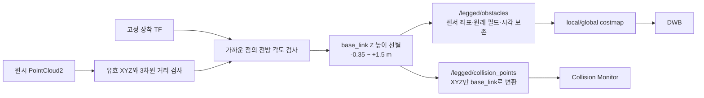

# 전방 근거리 장애물 필터

설정: `src/legged_bringup/config/obstacle.yaml`

필터는 **Livox Driver 내부가 아니라 `legged_navigation/obstacle_cloud`**에 있다.
Driver의 원시 출력은 localization·height mapping에서 계속 사용할 수 있다.
전방만 남기는 필터가 아니다. 전방 근거리 조건을 완화한 뒤, 다른 방향도 0.6m
밖의 점을 유지한다. 거리와 몸체 높이를 통과한 동일 점 집합을 costmap과
근접 충돌 감시에 사용하며, 두 출력은 좌표계 표현만 다르다.

```yaml
obstacle_cloud:
  ros__parameters:
    min_range: 0.6
    front_min_range: 0.3
    front_half_angle_deg: 60.0
    base_frame: base_link
    min_body_height: -0.35
    max_body_height: 1.5
    max_range: 5.0
```

전방 ±60°(전체 120°)에서는 센서로부터 0.3m 이상인 점을 허용하고, 그 밖의 방향에서는 기존 0.6m 이상만 허용한다. 최대 거리는 5m다. 거리는 센서 원점으로부터의 **3차원 거리**이며, 로봇 표면으로부터의 간격이 아니다.

`/tf_static`의 센서 → `base_frame` 회전으로 로봇 전방을 구한다. 각도 계산의 원점은 센서에 둔다. 따라서 센서의 장착 위치를 각도 벡터에 더하지 않는다. 동적 localization TF나 관절 TF는 사용하지 않는다. 고정 TF가 없으면 점군을 내보내지 않고 `missing_static_mount` 상태를 발행한다.



## costmap 설정

`config/costmap.yaml`의 local/global 양쪽 `obstacle_layer.livox_cloud.obstacle_min_range`는 **0.3**이다. 0.6을 유지하면 전처리에서 살린 전방 근거리 점을 다시 무시한다. 방향별 제외는 전처리가 담당한다.

장애물 높이는 전처리에서 `min_body_height <= (R_sensor_to_base * point + translation).z <= max_body_height`로 선별한다. 각도 검사와 달리 높이에는 장착 **이동량도** 포함한다. 이는 몸체 좌표축의 Z이므로 바닥으로부터의 높이가 아니며, 몸체 pitch/roll에 따라 선택 영역도 기울어진다. 현재 -0.35~+1.5m는 기존 Collision Monitor의 몸체 기준 범위와 같다. 보행 자세·단차·경사에 맞춘 범위 검증이 필요하다.

Nav2는 점군을 map으로 변환한 뒤 높이를 검사한다. 따라서 layer 자체와 `livox_cloud` 소스 모두 `min_obstacle_height: -10000.0`, `max_obstacle_height: 10000.0`으로 넓게 통과시킨다. 이 값은 장애물 높이 기준이 아니라 map 원점 이동에 대한 통과 범위다. 이 설정은 반드시 **높이 선별이 적용된 `/legged/obstacles`**와 함께 사용한다. 원시 점군을 직접 연결하면 바닥도 장애물로 표시할 수 있다.

현재 `map`은 2D Occupancy Grid와 localization이 공유하는 전역 좌표계다. 2D 지도 원점은 격자의 배치를 정의하며, 실제 바닥이 `map Z=0`이라고 보장하지 않는다. 2026-10-20 큐브 시험에서는 큐브 반사점의 map Z가 약 -0.35~+0.11m여서, 이전 map Z >= 0.2m 조건이 모두 제거했다.

- [Nav2 Humble: 전역 좌표 변환 후 높이 검사](https://github.com/ros-navigation/navigation2/blob/humble/nav2_costmap_2d/src/observation_buffer.cpp)

설정을 바꾼 뒤에는 navigation을 재시작한다. 현재 Humble obstacle layer에서는 관측 소스의 최소 거리가 초기 관측 버퍼 생성 시 전달되므로, 단순한 `ros2 param set` 성공만으로 적용됐다고 판단하지 않는다.

- [Nav2 Humble obstacle layer 구현](https://github.com/ros-navigation/navigation2/blob/humble/nav2_costmap_2d/plugins/obstacle_layer.cpp)

기존 일괄 거리 필터로 돌아가려면 `front_half_angle_deg: 0.0`으로 하고 costmap 최소 거리도 0.6으로 복원한 뒤 재시작한다.

## 연산 및 검증

C++ 기존 루프에서 처리한다. 점 수에 비례하는 O(N), 판정기 자체의 추가 메모리는 O(1)이다. 출력 점군 버퍼는 기존과 같이 O(N)이다. GPU/CUDA/CuPy 의존성은 추가하지 않는다.

0.6m 밖의 점은 방향 검사를 생략한다. 그 안의 후보 점만 고정 회전행렬의 두 행으로 투영한다. `atan2`, `sqrt`, 점별 TF 조회 없이, 시작 시 계산한 `cos²(half_angle)`와 곱셈·비교로 판정한다. 원시 point 필드와 시각은 유지하며 costmap의 ray clearing 원점도 센서 위치로 유지한다.

2026-10-20 개발 PC에서 저장된 80만 점을 대상으로 20회 준비 실행 후 100회 측정한 판정 루프의 중앙값:

| 판정 | 80만 점 | 4만 점으로 환산 |
|---|---:|---:|
| 일괄 0.6m | 0.873ms | 0.0436ms |
| 전방 0.3m / 그 외 0.6m | 0.880ms | 0.0440ms |

차이는 측정 변동보다 작다. 이 값에는 ROS 직렬화·점군 복사·좌표 변환·costmap 갱신이 포함되지 않는다. **Jetson CPU 점유율·지연 보장값이 아니다.** 실제 Jetson에서는 센서·localization·navigation을 함께 실행한 상태의 입력 빈도, 출력 지연, CPU 및 누락 scan을 측정한다.

위 측정은 방향·거리 판정만의 값이다. 이후 추가한 몸체 높이 선별은 통과 후보마다 회전행렬 한 행과 장착 Z 이동량으로 높이를 계산한다. 추가 GPU나 TF 조회는 필요하지 않는다.

범위·각도 경계, 잘못된 입력, 회전된 장착 TF, TF 미수신 시 출력 차단, 행 padding이 있는 PointCloud2, 필드·시각 보존을 검증했다. 자료는 `validation/front_sector_20261020/`에 있다.

몸체 높이 수정 후에는 바닥·상부 범위 제외와 pitch 장착 변환을 추가 검증했다. 큐브 재관측에서 동일 시각 104개 scan의 출력이 거리·각도·몸체 높이 조건과 모두 일치했다. 기존 map-Z 조건에서는 없던 큐브 관측면의 lethal 셀과 inflation이 local costmap에 생성됐다. 자료는 `validation/cube_height_fix_20261020/`에 있다. 두 관측 사이 로봇 자세가 조금 변했으므로 같은 자세의 엄밀한 A/B 시험은 아니다.

재생 요청 후 약 1.4초에 costmap 서비스 조회에서, 약 1.8초에 발행된 costmap에서 큐브를 확인했다. navigation 재시작 및 TF 대기가 포함된 관측값으로, 정상 운용 지연 또는 상한으로 사용하지 않는다. 이 시험에서는 주행 목표를 보내지 않았으므로 실제 DWB 우회 성능은 검증하지 않았다.

## 현재 검증 한계

±60°는 시뮬레이션 시험 프로파일이다. 초기 정지/짧은 움직임 기록에서는 새로 통과하는 점 중 현재 Collision Monitor 높이 범위의 점이 없었지만, 양방향 보행 명령을 실제 GT 움직임이 충분히 재현하지 못했다. 완전한 보행 범위의 자기 반사 검증과 0.3~0.6m 전방 장애물 검출 시험은 남아 있다.

필터 변경은 navigation 장애물 입력만 변경한다. Localization·height mapping
입력은 유지한다. 아래의 외곽 조정은 별도 변경이다. 필터 밖의 실제 장애물이나
센서가 측정하지 못한 장애물을 복원하지 않으며, 가까운 장애물이 추가 통과하면
costmap/Collision Monitor의 정지가 늘어날 수도 있다.

## 2026-10-20 로봇 외곽과 정지 범위

현재 시험 기본값은 `collision.yaml`의 `Stop.points`에 정의한
**앞뒤 0.70m × 좌우 0.65m**이다. 실행 중인 Gazebo 모델 메시와 기록된 관절 TF
40개 시각에서 얻은 외곽은 X [-0.2145, 0.1990], Y [-0.2462, 0.2460]m였다.
카메라·LiDAR·양쪽 다리를 포함한 관측 자세의 투영이며, 최대 보폭/옆걸음 등
전체 보행 외곽이나 실제 하드웨어 치수를 보증하지 않는다.

`navigate.launch.py`는 이 설정으로 다음을 함께 구성한다.

- Collision Monitor의 현재 점군 정지 사각형.
- local/global costmap footprint. 별도 padding은 0이며 위 사각형에 여유가 포함된다.
- DWB `ObstacleFootprint` critic이 읽는 사각형.
- 최종 command watchdog의 현재/예측 지도 충돌 사각형.

DWB는 local costmap에서 2초 후보 궤적의 footprint 외곽을 검사하고,
final guard는 global costmap에서 1초 일정 Twist 궤적의 **채워진 사각형**을 검사한다.
격자 교차와 중간 움직임을 포함하는 final guard가 조금 더 보수적일 수 있다.
형상을 공유해도 서로 다른 지도·시간 범위·검사 방식 때문에 모든 판정이 같지는 않다.
Global planner의 추가 clearance 0.45m는 별도로 유지한다.

공식 구현:
[Humble ObstacleFootprint](https://github.com/ros-navigation/navigation2/blob/humble/nav2_dwb_controller/dwb_critics/src/obstacle_footprint.cpp).

근접 거리 필터, 높이 범위, 1초 예측 시간, 센서 timeout 정지는 유지한다.
정지 영역을 줄여도 0.6m 안쪽 측후방 센서 사각지대가 줄어드는 것은 아니다.
현재 표면 관측이 없으면 과거 지도 관측을 확인할 수 있지만 새 물체의 검출은 보장하지 않는다.

이번 40개 점군 기록에서는 필터 출력 209,267개가 모두 world의 정적 형상과
4cm 이내로 일치했다. 1m 안쪽 22,200개는 실제 벽이며, 이 구간에서 바닥이나
자가 반사가 확인되지 않았다. 반면 마지막 global costmap에는 정적 지도 장애물에서
10cm 넘게 떨어진 lethal 셀이 154개 남았다. 현재 점군만으로 그 과거 흔적의
발생 원인을 확정할 수 없다. `observation_persistence: 0`은 지도 셀의 자동
만료 시간이 아니다. 이번에는 장애물 셀을 지우거나 전방 전용 필터를 추가하지 않았다.

빌드, Python 회귀 36개, 격리된 ROS 도메인의 DWB 통합 시험을 통과했다.
실제 launch의 footprint 일치, 장애물 우회 경로, 속도 명령 생성, 근접 물체 정지,
센서 중단 정지를 확인했다. Gazebo의 새 설정 주행과 전체 보행 외곽 검증은 남아 있다.
자료: `validation/self_returns_20261020/report.html`.
