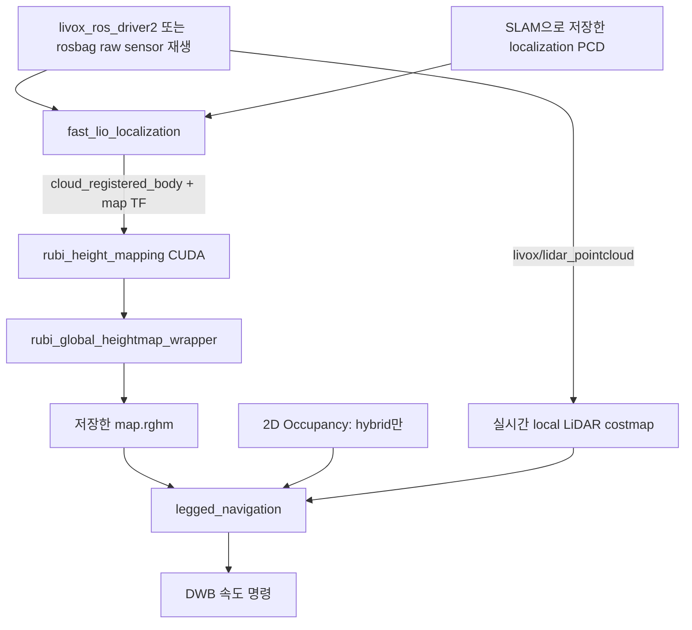

# RUBI height mapping·navigation 구성

현재 운용은 각 패키지를 직접 실행합니다. 모든 명령을 한 파일에서 읽으려면 [운용 안내 HTML](report.html)을 사용합니다.

## 데이터 흐름

## 실행과 설정

| 기능 | 직접 실행 | 설정/출력 |
|---|---|---|
| Driver | `livox_ros_driver2 msg_MID360s_launch.py` | MID360s_config.json, CustomMsg + PointCloud2 + IMU |
| 새 PCD 취득 | `fast_lio mapping.launch.py` | config/mid360.yaml, pcd_map 경로 |
| PCD localization | `fast_lio_localization localization_nav_rubi.launch.py` | input_format:=custommsg, pcd_map |
| Height 취득 | `rubi_height_mapping mapping.launch.py` | config/height_mapping.yaml, global_heightmap.yaml, save_dir |
| Hybrid navigation | `legged_navigation height_hybrid_navigation.launch.py` | height_hybrid.yaml + nav2_common.yaml |
| Height-only navigation | `legged_navigation height_only_navigation.launch.py` | height_only.yaml + nav2_common.yaml |

SLAM과 localization은 동일 입력·출력 토픽/TF를 사용하므로 동시에 실행하지 않습니다. Height 생성에는 CUDA/CuPy가 필요하며 저장 지도 탐색은 CPU에서 실행합니다. Global planner는 공유 StepGrid A*와 frozen terrain cache를 사용합니다.

실제 주행의 `/cmd_vel` 수신 bridge는 별도로 실행합니다. 현재 직접 launch에 별도 command watchdog/Collision Monitor가 자동 포함된다고 가정하지 않습니다. Height-only는 global 2D 장애물 비용을 제거하며 local DWB의 LiDAR 장애물 처리는 유지합니다.

- [설치 및 버전](INSTALL.md)
- [실물 실행 순서](OPERATIONS.md)
- [Rosbag 실행 순서](HEIGHT_REPLAY.md)
- [DDS 프로토콜](DDS.md)
- [튜닝](TUNING.md)
- [최근 검증 범위](DELIVERY_VALIDATION.md)
- [소스 출처](THIRD_PARTY.md)
