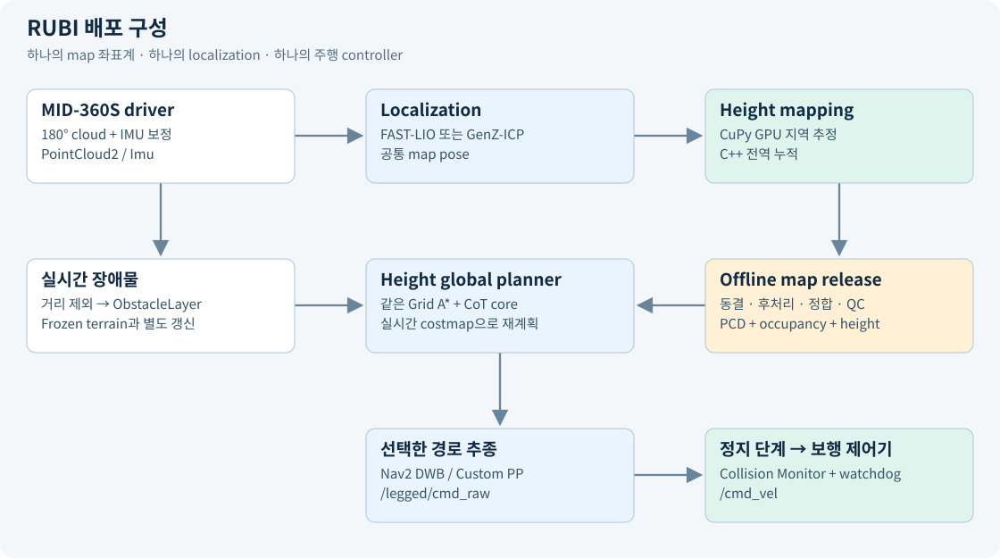
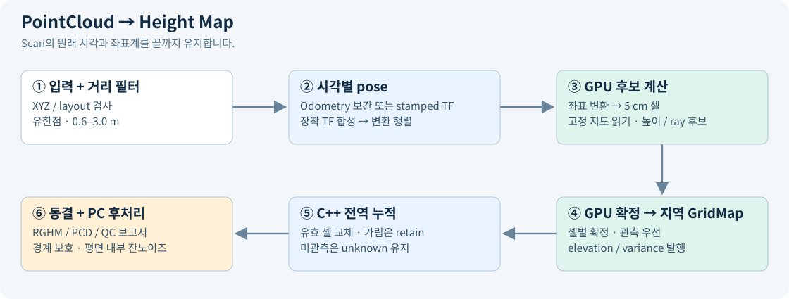
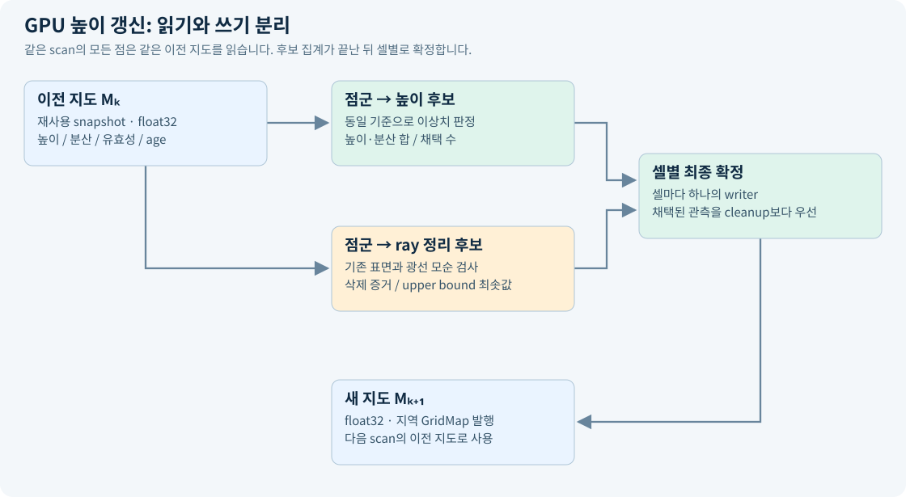

# RUBI height mapping·navigation 배포 기술 보고서

작성 기준: 2026-10-15 · 배포 위치: `/home/kim/legged_robot_ws` · ROS 2 Humble

## 1. 목적과 이번 구성의 범위

본 workspace는 point-foot biped인 RUBI의 비전 PC에서 사용할 센서 입력, localization, 2.5D 높이 지도, 전역 경로, 경로 추종을 묶습니다. Jetson Orin NX 16 GB / 25 W가 대상이지만, 이번 실행 검증은 PC에서 수행했습니다.

범위는 **공통 map 좌표계의 frozen 전역지도 + 주행 중 장애물 관측 + 선택적 지역 height mapping**입니다. 경사로와 단차를 이름으로 분류하는 기능, 발 디딤 위치·보행 동역학·낙상 회피 제어는 구현하지 않습니다. `/cmd_vel`은 로봇의 기존 보행 제어기에서 받아 실행하는 몸체 이동 명령입니다. 자동차의 차선 지도로 바꾸거나 차량 모델을 적용하는 구성이 아닙니다.

## 2. 전체 데이터 흐름



```mermaid
flowchart TD
  S[MID-360S · upside-down] --> D[Livox driver · cloud/IMU 축 보정]
  D --> P[PointCloud2 · 점별 절대 ns]
  D --> I[IMU · sensor timestamp]
  P --> L[FAST-LIO localization]
  I --> L
  P --> G[GenZ-ICP localization · 대안]
  L --> C[움직임 보정 점군 + map pose]
  C --> H[CuPy/CUDA 지역 높이 추정]
  H --> A[C++ 전역 누적 wrapper]
  A --> F[동결 저장 · RGHM + PCD]
  F --> O[PC 오프라인 후처리 · 정합 · QC]
  O --> B[PCD + Occupancy + Height 지도 세트]
  B --> R[Frozen height server]
  B --> M[Nav2 map server]
  P --> X[거리 필터 → 장애물 costmap]
  R --> Q[공통 Height Grid A* + CoT 비용]
  M --> Q
  X --> Q
  Q --> N[Nav2 DWB 또는 Custom Pure Pursuit]
  N --> Z[근접 충돌 정지 + 데이터 갱신 watchdog]
  Z --> V[/cmd_vel → 기존 보행 제어기]
```

GenZ 경로는 대안 localization입니다. 현재 GenZ 설정의 `deskew:false`를 그대로 유지하며, FAST-LIO의 IMU 기반 deskew와 동등하다고 가정하지 않습니다. GenZ를 선택한 상태에서 원시 점군으로 높이를 취득하려면 정지 취득부터 검증하고 이동 중 변형을 별도로 평가해야 합니다.

## 3. 패키지와 책임

| 구성 | 입력 → 출력 | 처리 위치 |
|---|---|---|
| `livox_ros_driver2` | SDK packet → upright PointCloud2 / IMU | CPU |
| `fast_lio_localization` | 점군·IMU·PCD → local odom, 전역 pose, deskewed cloud | CPU |
| `genz_icp` | 점군·PCD → local/global odometry | CPU |
| `rubi_height_mapping` | 점군·pose → 지역 GridMap elevation/variance | ROS 처리 CPU + 추정 GPU |
| `rubi_global_heightmap_wrapper` | 지역 GridMap → 지속 전역 높이·저장 파일 | C++ CPU |
| `rubi_heightmap_postprocess` | 저장 snapshot → 원본/후처리 비교·QC | 오프라인 PC CPU |
| `rubi_heightmap_step_wavefront_planner` | 높이·costmap → 전역 Grid A* 경로 | C++ CPU |
| `legged_navigation` | 공통 core의 Nav2 adapter / 기존 Pure Pursuit / 거리 필터 | C++ CPU |
| `legged_bringup` | 실행 구성·frozen 지도·최종 command watchdog | Python/ROS |
| `fast_lio` | 새 PCD 취득용 기존 FAST-LIO mapping 소스 | CPU, 선택적 |

`elevation_mapping_cupy` 전체 패키지는 필요하지 않습니다. 다만 높이 추정 알고리즘은 기존 upstream에서 파생되었고, CUDA·CuPy 의존성은 남습니다. 직접 작성한 전역 누적 wrapper와 GPU 추정기는 별도 역할입니다.

상위 사용자는 `legged_bringup`의 짧은 launch와 config만 다룹니다. Height 취득은 `ros2 launch legged_bringup mapping.launch.py`로 실행하고, 입력·frame·clock·저장·RViz는 `config/mapping.yaml`에서 관리합니다. 기본은 FAST-LIO 기반 시뮬레이션이며 실물에서는 `use_sim_time: false`로 변경합니다. upstream 패키지 이름과 source 구조는 비교·업데이트를 위해 유지했습니다. upstream의 오래된 비교 실험 launch는 공개 실행 경로가 아니며, `legged_bringup` 사용법을 기준으로 합니다.

## 4. PointCloud2가 높이 지도로 바뀌는 과정



### 4.1 센서 입력과 전처리

Driver는 Livox packet을 PointCloud2로 묶고 `x,y,z,intensity,tag,line,timestamp`를 보존합니다. Upside-down 설치에 맞춰 점과 IMU 벡터를 `Rx(π)`로 회전합니다. 점군 좌표축을 바꾸는 것과 각 점이 측정된 시간을 바꾸는 것은 별개의 처리입니다.

FAST-LIO에는 전체 360° 점군과 IMU가 들어갑니다. `preprocess.blind=0.6`으로 가까운 반사점을 제외하고, 점별 시간을 사용해 움직임을 보정합니다. 전역 정합은 기존 PCD 지도와 현재 scan을 정합해 `map→camera_init`을 계산합니다.

Height mapping의 기본 입력은 `/cloud_registered_body`입니다. 이는 **scan 종료 시점의 IMU body frame**으로 보정된 점군이며 `/localization`도 같은 scan 시각을 유지합니다. 물리 sensor origin으로 되돌린 cloud는 아닙니다. 따라서 이 입력의 0.6 m 거리 마스크는 정확히는 IMU-body origin 기준이고, LiDAR와의 수 cm translation이 있습니다. 원시 `/livox/lidar`를 넣으면 거리 기준은 LiDAR origin이지만 mapper 자체에는 deskew가 없습니다.

Height node는 다음을 수행합니다.

1. PointCloud2 field type, stride, row padding, data 크기를 확인합니다.
2. 유한한 XYZ만 남깁니다.
3. 입력 frame 원점 기준 3D 거리 범위(기본 0.6–3.0 m)를 적용합니다.
4. 원래 scan stamp를 유지한 채 pose가 준비될 때까지 유한 길이 큐에서 대기합니다.
5. CPU의 NumPy 점 배열을 CuPy 배열로 옮겨 GPU kernel에 전달합니다.

관절 TF는 필요하지 않습니다. 다만 거리 마스크는 전신 self-filter의 대체 보증이 아니며, 0.6 m 밖으로 나온 다리나 손, 가까운 외부 장애물도 구분하지 못합니다. 이 한계 때문에 localization·height·navigation의 입력 사용 목적과 범위를 각각 명시합니다.

### 4.2 Scan 시각의 pose 결정

지원 모드는 두 가지입니다.

| 모드 | 동작 |
|---|---|
| `odom_topic` 지정 | nav_msgs/Odometry 캐시에 scan 시각을 끼우는 두 pose를 찾고, translation 선형보간·quaternion SLERP 수행 |
| `odom_topic` 빈 문자열 | scan의 원래 timestamp로 TF 조회 |

직접 odometry 모드는 parent frame이 `map_frame`과 같아야 합니다. `/Odometry`는 `camera_init→body`이므로, map 기준 전역 높이 생성에 기본으로 쓰는 `/localization`과 같은 의미가 아닙니다. GenZ의 전역 pose는 `/genz/localization_odom`입니다.

직접 pose 입력에서는 **장착 관계만 `/tf_static`**에서 읽습니다. 전역 pose와 또 다른 dynamic TF를 섞지 않습니다. 예를 들어:

```text
T_map_sensor(t) = T_map_odom_child(t) · T_odom_child_sensor
p_map = R_map_sensor(t) · p_sensor + t_map_sensor(t)
```

Scan 시각을 끼우는 odometry가 없으면 extrapolation하지 않습니다. 기본 wait timeout은 1.5 s, odom 최대 보간 간격은 0.2 s입니다. 시작 이전의 몇 scan이 버려지는 것과, 운용 중 지속해서 pose가 맞지 않는 문제를 구분합니다. Clock 역행이나 fusion 실패는 조용히 최신 TF로 대체하지 않습니다.

이 구조는 localization 오차를 제거하지 않습니다. 입력 pose의 roll/pitch/z 오차는 변환된 바닥에 그대로 나타날 수 있습니다. covariance/twist를 높이 uncertainty로 전파하는 기능도 현재 구현에 포함되지 않습니다.

### 4.3 지역 grid와 좌표

기본 지역 지도 길이는 8 m, 해상도는 0.05 m입니다. 외부 유효 영역은 160×160 셀이며 kernel용 테두리 padding이 있습니다. 로봇 이동에 맞춰 지역 지도를 정수 셀 단위로 이동시키고 새로 들어온 영역은 unknown으로 둡니다.

내부 배열은 row=Y, column=X입니다. 전역 셀 중심은 다음으로 해석합니다.

```text
x = origin_x + (column + 0.5) × resolution
y = origin_y + (row    + 0.5) × resolution
```

GPU 내부 배치, GridMap의 matrix/circular-buffer convention, C++ wrapper의 row-major 배열 사이를 명시적으로 변환합니다. 과거 축 교환·부호·rolling center 누적 반올림 문제의 수정본과 회귀시험을 유지했습니다.

5 cm 셀은 하나의 높이값만 저장합니다. 수직 모서리에 위·아래 점이 섞일 수 있으며, 같은 XY의 복수 층·천장·교량을 모두 표현하는 3D voxel map이 아닙니다. SDF/ESDF와도 다릅니다.

### 4.4 GPU 측정 결합

Kernel은 좌표 변환, 유효 영역 판정, 셀 연결, height/variance 결합을 수행합니다. 기본 센서 noise proxy는 다음과 같습니다.

```text
v = sensor_noise_factor × (x_sensor² + y_sensor² + z_sensor²)
sensor_noise_factor = 0.05
```

기존 셀 높이를 `h`, variance proxy를 `V`, 새 점 높이를 `z`, 새 점 proxy를 `v`라 하면 결합 후보는:

```text
h_candidate = (h × v + z × V) / (V + v)
V_candidate = (V × v) / (V + v)
```

0.3.1은 scan 시작 시 이전 지도를 재사용 버퍼에 복사하고, 모든 점이 같은 높이·분산을 읽도록 합니다. 높이 후보를 별도 버퍼에 atomic accumulation하고 후속 kernel에서 셀별 평균을 확정합니다. 모든 점을 하나씩 순차 Kalman update한 결과와 완전히 동일하다고 설명해서는 안 됩니다.

Outlier 판정은 코드에서 `abs(h-z) > V × mahalanobis_thresh` 형태입니다. 이름만 보고 정규분포의 표준편차 기반 Mahalanobis 거리라고 해석하지 않습니다. 임계 초과 횟수를 기록하고, 해당 셀에 채택된 관측이 없을 때 최종 단계에서 variance proxy를 증가시킵니다. 점을 검사하는 중에는 판정 기준인 V를 바꾸지 않습니다. 이 값은 센서·pose 전체 오차를 교정한 통계적 posterior confidence가 아닙니다.



높이 관측 후보와 ray 정리 후보는 별도 버퍼에 기록합니다. 두 계산이 같은 GPU kernel에서 실행되어도 읽는 지도는 고정되어 있고, 쓰는 버퍼도 구분되므로 서로의 판단 기준을 덮어쓰지 않습니다. 모든 후보 계산이 끝난 뒤 동일 CUDA stream의 다음 kernel에서 셀마다 하나의 작업이 최종 상태를 씁니다.

1. 유효한 높이 관측이 채택되면 평균 높이·분산으로 갱신하고 age=0, upper bound=새 높이로 확정합니다. 같은 scan의 ray 삭제 후보보다 우선합니다.
2. 채택된 관측이 없으면 outlier 횟수와 ray 모순 증거를 반영합니다. 여러 ray가 제안한 upper bound는 최솟값을 취합니다.
3. 미관측 셀에 ray upper bound만 생겨도 유효한 지면으로 바꾸지 않습니다. 가려져서 새 증거가 없는 셀은 유지합니다.

상태·점별 추정값은 float32를 유지하고, 후보 합산은 float64로 수행해 덧셈 순서에 따른 반올림 영향을 줄였습니다. 모든 GPU·모든 입력에서 비트 단위 동일성을 보장한다는 뜻은 아닙니다. 버퍼는 재사용하며 기본 162×162 내부 grid에서 추가 상주 메모리는 약 2.0 MiB입니다. 센서 전처리·pose 계약·기존 ray 경로와 높이 추정식은 유지했고, DDA traversal이나 upstream 전체 패키지는 도입하지 않았습니다.

이는 localization 오차를 교정하는 기능이 아닙니다. 이전 GT/LIO 주행 비교와 달리 이번 반복성 시험은 저장 XYZ와 합성 고정 pose만 사용해 추정기 내부의 재현성을 검사했습니다. [검증 기록](VALIDATION.md)의 2026-10-15 snapshot fusion 절을 참조합니다.

내부적으로 elevation, variance, validity, traversability, age, upper bound 관련 일곱 층을 유지합니다. 시간 경과에 따른 variance 증가, ray가 기존 표면을 통과하는 경우의 visibility cleanup, normal 계산이 있습니다. 내부 traversability 점수는 기존 작은 convolution 모델을 CuPy kernel로 옮긴 것이며, 별도 PyTorch/Chainer runtime이나 영상 입력을 요구하지 않습니다. 이 점수는 내부 cleanup에 사용하고, 검증된 보행 안전도 layer로 외부에 제공하지 않습니다.

Drift compensation과 edge sharpening은 기본 비활성입니다. 넓은 바닥 휨을 강제로 평탄화하여 localization 오차를 숨기는 동작은 하지 않습니다. 외부에는 raw elevation/variance GridMap을 발행합니다.

### 4.5 전역 누적 wrapper

기본 전역 범위는 50×50 m, 해상도 5 cm, 원점 (-25,-25)입니다. 사이트가 더 크거나 원점이 다르면 `global.yaml`에서 바꿉니다.

Wrapper의 동작은 이미 추정된 지역 높이의 **지속 저장**입니다. 원시 pointcloud를 다시 CPU로 융합하는 구현이 아닙니다.

| 입력 상황 | `invalid_cell_policy=retain`의 동작 |
|---|---|
| 새 유효 지역 셀 | 해당 전역 셀을 새 추정 높이·variance로 교체 |
| NaN / 높은 variance / 가림 | 이전에 받아들인 전역 셀을 유지 |
| 한 번도 관측되지 않은 셀 | unknown 유지 |
| 지역 window 밖 | 기존 전역 셀 유지 |
| 같은 snapshot stamp 재발행 | 중복 갱신하지 않음 |
| frame/resolution/격자 경계 불일치 | 거부 |
| 뒤로 가는 timestamp | 거부; 새 세션은 명시적으로 초기화 |

따라서 occlusion 때문에 지역 지도가 지워져도 전역이 함께 비지 않습니다. 반대로 **사라진 장애물을 정적 높이 지도에서 자동으로 지운다는 보장은 없습니다.** 실시간 장애물은 별도의 costmap이 다룹니다.

셀에 저장하는 시간은 `estimate_snapshot_ns`, 즉 받아들인 지역 추정 snapshot의 시각입니다. 셀별 마지막 원시 ray 관측시각을 정밀하게 추적하는 값은 아닙니다. 이 의미를 후처리와 배포에서도 유지합니다.

### 4.6 동결·저장·불러오기

`save_map` 서비스는 현재 전역 상태의 일관된 snapshot을 파일로 저장합니다. 온라인 mapping 전체를 영구 정지시키는 명령은 아닙니다. 저장된 파일이 이후 업데이트의 영향을 받지 않는다는 의미로 frozen snapshot을 사용합니다.

- `map.rghm`: frame, resolution, origin, dimensions, 높이, variance, usability, snapshot 시각을 보존합니다.
- `surface.pcd`: 유효한 셀 중심의 XYZ를 출력합니다. 미관측 mask 전체와 모든 provenance를 대체하는 형식은 아닙니다.
- 새 `frozen_map` 서버는 CuPy 없이 `.rghm`을 읽고 `/legged/height`와 `/legged/height_info`를 발행합니다.
- 반복 발행해도 acquisition stamp는 원래대로 둡니다. Planner의 `static_heightmap=true`는 frozen layer의 age/skew 검사만 제외합니다. 실시간 장애물·odom·command의 freshness 검사는 유지합니다.

## 5. 오프라인 후처리와 모서리 처리

후처리는 Jetson에서 상시 실행할 필요가 없습니다. 원본을 덮어쓰지 않고 PC에서 후보를 생성한 뒤 QC합니다.

현재 `rubi_heightmap_postprocess`는 두 후보를 비교합니다.

| 방법 | 처리 |
|---|---|
| Baseline | 반경 6 cm의 유효 이웃 평균, unknown mask 복원 |
| Conservative candidate | 경계·unknown 인접부를 보호하고 평면 내부만 제한적으로 보정 |

Candidate는 3×3 이웃 height span이 25 mm를 넘는 경계를 찾고 한 셀 추가 보호합니다. 연결된 내부 영역에 robust plane을 맞춰 residual P95 ≤4 mm, 변경 최대 10 mm 등의 조건을 통과하면 적용합니다. 큰 영역이 비평면이면 같은 영역 내부 7×7 local plane을 사용하며 RMS ≤3 mm, 변경 최대 10 mm 조건을 적용합니다.

이 알고리즘에서 plane은 잔노이즈 제거를 위한 근사 모델입니다. “경사로” 또는 “단차”라는 terrain class를 생성하지 않습니다. 기울어진 plane도 조건을 만족하면 처리할 수 있습니다. 큰 비선형 localization 변형을 해결하거나, 실제 모서리를 GT world에 맞춰 잘라내지 않습니다.

후처리 결과의 variance는 원본 provenance를 유지하며 새 통계적 uncertainty로 재계산한 값이 아닙니다. Unknown 영역을 채우지 않고 XY와 격자 해상도를 유지합니다. 5 cm 셀 안의 실제 경계 위치를 추가 관측 없이 복원할 수 없으므로, planner는 경계 주변 이웃과 noise floor를 고려합니다.

## 6. 세 지도 정합과 배포

PCD localization map, 2D occupancy map, height map을 하나의 site version으로 관리합니다. 좌표계 이름이 모두 `map`이라는 사실만으로 공간적으로 정합된 것은 아닙니다.

권장 흐름은 **이미 정합한 PCD/occupancy의 map frame을 기준으로 localization하고, 같은 map pose로 height를 새로 취득**하는 것입니다. 이 경우 별도 height ICP를 기본 단계로 추가할 필요는 없지만 landmark와 높이 datum QC는 여전히 필요합니다.

다른 frame에서 만든 height는 구조물·대응점으로 측정한 `T_map_from_height`를 적용해야 합니다. `tools/align_height.py`는 주어진 rigid transform을 적용하고 관측 셀 중심을 새 격자에 넣습니다. 자동 registration solver가 아닙니다. 회전·기울기에 따른 여러 점의 셀 충돌에서 높이 span이 25 mm를 넘으면 unknown으로 제외하며, 미관측 영역을 메우지 않습니다. Registration uncertainty는 별도 QC 기록 대상입니다.

`tools/package_site.py`는 검토된 QC record와 지도들을 새 폴더로 복사하고 SHA-256을 기록합니다. Runtime은 checksum과 frame·resolution을 확인하고 섞인 버전이나 미확인 정합 기록을 거부합니다. `maps/demo`의 평면 지도는 이 과정과 launch를 시험하기 위한 합성 데이터이며 실제 localization 성능을 보여주지 않습니다.

## 7. Height 기반 전역 planning

두 주행 모드는 같은 `StepGridAStarPlanner` core를 사용합니다. 기존 비교용 node를 Pure Pursuit 쪽에 연결하고, Nav2에는 같은 core를 호출하는 `HeightPlanner` plugin을 추가했습니다.

공통 입력은 2D costmap과 frozen height입니다. 비용은 거리, inflation, height를 함께 사용합니다. 현재 배포 profile은 CoT 기반 equivalent-distance table과 height weight 1.0을 활성화합니다. 표는 RUBI 기존 실험값을 가져온 것이며 다른 기체의 에너지 소비를 보장하는 물리 상수는 아닙니다.

주요 기본값은 5 cm height resolution, 1 cm noise floor, 최대 허용 높이 변화 10 cm, 반경 10 cm 이웃 evidence, quantile 기반 local relief, 위험 높이 경계에서 20 cm 여유입니다. 단순히 바로 인접한 두 셀의 높이차만 보는 구조가 아닙니다. Unknown 또는 충분하지 않은 height evidence는 통과 가능으로 만들지 않습니다.

Static occupancy map에서 이미 occupied인 낮은 구조물은 height layer가 있다고 자동으로 통과 허용되지 않습니다. 사이트 지도 제작 시 “통과 가능한 terrain”과 “몸체 충돌 장애물”을 2D map의 생성 기준에 맞춰 처리해야 합니다. 이는 ramp/step semantic classification을 새로 추가한다는 뜻이 아닙니다.

## 8. Pure Pursuit의 장애물 회피 연결

Pure Pursuit 자체는 주어진 경로를 따라가는 controller입니다. 장애물 정보를 받아 새 경로를 만드는 알고리즘은 아닙니다.

| 항목 | Nav2 모드 | Pure Pursuit 모드 |
|---|---|---|
| 전역 route | 공통 Height Grid A* plugin | 공통 Height Grid A* standalone node |
| 실시간 장애물 | global/local ObstacleLayer | global ObstacleLayer |
| 우회 | 주기적 전역 재계획 + DWB 지역 회피 | 기존 route 검사 → 무효 시 정지·전역 재계획 |
| 경로 추종 | Nav2 controller_server / DWB | 기존 custom Pure Pursuit |
| 근접 장애물 | 공통 Collision Monitor | 공통 Collision Monitor |
| 데이터 중단 | 공통 최종 watchdog | 공통 최종 watchdog |

```text
/livox/lidar → range filter → /legged/obstacles
                                ├→ ObstacleLayer → 새 전역 route
                                └→ Collision Monitor

selected controller → /legged/cmd_raw → Collision Monitor
                    → /legged/cmd_safe → watchdog → /cmd_vel
```

기존 비교 profile의 `replanning.enabled:false`를 새 배포 profile에서는 true로 바꿨습니다. 장애물이 기존 경로를 막으면 빈 tracking path로 추종을 중지하고 우회 경로를 계산합니다. 새 경로가 없으면 정지 상태를 유지합니다. 장애물 검출을 정지만으로 해결했다고 설명하지 않으며, 반대로 재계획을 켰다는 이유만으로 갑작스러운 근접 충돌 대응이 보장된다고도 설명하지 않습니다.

최종 watchdog은 command와 cloud·odom·costmap의 수신 및 timestamp를 검사합니다. 이는 사용한 Humble Collision Monitor의 version 차이에만 freshness 동작을 맡기지 않기 위한 구성입니다. 두 controller를 동시에 실행하지 않습니다. Nav2 BT에는 자동 후진·회전 recovery를 넣지 않아 height 검사를 거치지 않은 임의 recovery 이동을 시작하지 않습니다.

Costmap height gate는 이 profile에서 **map frame의 z=0 지면**을 기준으로 시작하며, Collision Monitor gate는 **base_link 기준**입니다. 서로 같은 숫자를 무조건 복사하지 않습니다. 0.6 m 거리 제외는 가까운 외부 장애물도 제외하므로, 정지 zone과 실제 보행 속도·정지 거리를 함께 실측해야 합니다. 현재 초기 속도 상한은 0.3 m/s입니다.

## 9. 자원과 Jetson 운영

GPU로 옮긴 것은 높이 kernel입니다. ROS 수신·TF/odometry·pointcloud layout 처리, C++ 누적, FAST-LIO/GenZ 정합, Nav2와 planner는 CPU 작업이 남습니다. GPU 사용률을 높이면 모든 CPU 부하가 없어지는 구조가 아닙니다.

실제 주행 세션에서는 frozen map + 선택한 localization 하나 + 선택한 controller 하나를 기본으로 운영합니다. 지역 height mapping이 필요한 실험에서만 GPU mapper를 추가합니다. offline 후처리, RViz, map 취득용 FAST-LIO mapping을 항상 함께 띄울 필요는 없습니다.

Orin 검증에는 `tegrastats`로 RAM·GPU·CPU·thermal throttling과 scan queue 대기, drop 수, pose 지연, navigation 지연을 함께 기록합니다. 이 PC의 통과 결과로 25 W 조건의 처리율이나 FastDEM 대비 우열을 확정하지 않습니다. JetPack/CUDA를 확인한 뒤 실제 센서 replay와 보행 로그로 acceptance 범위를 정합니다.

## 10. 검증과 납품 판단

검증 결과는 [VALIDATION.md](VALIDATION.md)에 정리했습니다. 실제 ROS launch에서 frozen stamp 보존, 두 모드의 경로 생성, 장애물 우회, nonzero command, 근접 정지와 stale sensor 정지를 확인했습니다. GPU 추정·직접 odometry·장착 변환 시험도 수행했습니다.

추가 실물 확인 항목은 MID-360S clock/축/장착 translation, Jetson JetPack와 자원 여유, 실제 PCD/occupancy/height 정합 오차, 보행 중 self-return 범위, 관측 사각지대와 정지 거리입니다. Localization 알고리즘 자체의 연구 개선은 이 배포 작업 범위에 포함하지 않았습니다.

기존 FAST-LIO 폴더의 `package.xml` license 표기와 `LICENSE` 내용에는 차이가 있으므로 전체 workspace를 하나의 MIT 패키지라고 표기하지 않습니다. 원본 license를 보존하고 구성요소별 출처를 [THIRD_PARTY.md](THIRD_PARTY.md)에 기록했습니다.

## 11. 읽을 코드

- [Timestamp decoder](../src/FAST_LIO_LOCALIZATION2/include/livox_time.hpp)
- [Height ROS 입력·pose queue](../src/rubi_height_mapping/rubi_height_mapping/node.py)
- [GPU height core](../src/rubi_height_mapping/rubi_height_mapping/core.py) · [CUDA kernels](../src/rubi_height_mapping/rubi_height_mapping/kernels.py)
- [C++ 전역 저장 정책](../src/rubi_global_heightmap_wrapper/src/global_grid.cpp)
- [후처리 필터](../src/rubi_heightmap_postprocess/rubi_heightmap_postprocess/filters.py)
- [공통 Grid A*](../src/rubi_heightmap_step_wavefront_planner/src/planning/step_grid_astar_planner.cpp)
- [Nav2 adapter](../src/legged_navigation/src/height_planner.cpp)
- [최종 명령 watchdog](../src/legged_bringup/legged_bringup/command_watchdog.py)

외부 근거: [Livox 공식 driver](https://github.com/Livox-SDK/livox_ros_driver2/tree/21445540f0d100dc86a7e6df312dd70bbdb4afdf), [Humble ObstacleLayer](https://github.com/ros-navigation/navigation2/blob/humble/nav2_costmap_2d/plugins/obstacle_layer.cpp), [Humble Collision Monitor](https://github.com/ros-navigation/navigation2/blob/humble/nav2_collision_monitor/src/collision_monitor_node.cpp), [CuPy 설치](https://docs.cupy.dev/en/v13.6.0/install.html).

## 추가: GPU를 유지한 경량화 (2026-10-15)

현재 높이 융합은 이미 CUDA/CuPy에서 실행합니다. NumPy→CuPy로 바꾸는 작업을 새로 시작하는 단계가 아닙니다. CPU는 ROS 수신·XYZ 추출·거리 마스크·pose 보간·메시지 발행을 맡고, 전역 누적은 C++ CPU wrapper가 맡습니다.

2026-10-15에는 중복 GPU finite 검사, layer별 host 복사, Python float 목록 생성을 줄였습니다. 5 cm 해상도와 추정 알고리즘은 그대로이며, 수치 결과와 ROS 직렬화 호환성을 확인했습니다. 자세한 조건과 결과는 [검증 기록](VALIDATION.md)을 따릅니다. 이 변경만으로 이전 화면 지연의 원인을 확정하거나 Jetson 성능을 보장하지 않습니다.

Jetson 운영의 우선순위는 QC한 frozen 전역지도를 로드하여 planner에 제공하고, 필요한 경우에만 작은 지역 지도를 GPU에서 갱신하는 것입니다. 취득 중 전역 누적·시각화가 필요할 때와 배포 후 frozen 지도를 사용하는 때의 계산량을 구분합니다. RViz는 개발 PC에 두고, 발행 주기는 제어·planner가 요구하는 값에 맞춥니다. Grid 크기나 해상도를 줄이는 설정은 품질·범위의 변경이므로 이번 최적화에는 적용하지 않았습니다.

## 추가: 높이 융합과 ray 선택의 역할 분리

`ray_mode=voxel` 경로는 다음 순서입니다.

```text
전체 XYZ → 기존 GPU 좌표변환·inlier 계수 + 3D voxel 대표 index 선택
                ↓
전체 점의 높이 융합 → 선택된 원래 점만 visibility cleanup
                ↓
기존 셀별 집계·내부 traversability·normal → GridMap → 전역 wrapper
```

ray 선택은 기존 첫 번째 kernel에 합쳐 좌표를 다시 계산하거나 CPU로 index를 가져오지 않습니다. 별도의 GPU 정렬·가변 크기 점군 압축도 하지 않습니다. 각 voxel에서 가장 앞선 원래 입력 index를 선택하고 메모리 버퍼를 재사용합니다. hash 탐색 한계 또는 좌표 범위 초과 시 해당 원래 ray를 그대로 검사합니다.

FastDEM의 ray 입력 축소 구조를 참고했으나 자체 CUDA 구현이며, FastDEM 높이 추정 방식을 복사한 것은 아닙니다. 선택 ray는 기존과 같은 cleanup 검사를 통과해야 합니다. 각 ray의 증거 강도를 줄어든 점 수만큼 임의로 증폭하지 않습니다. 그 결과 제거가 늦어지는 경우가 있으며 실제 저장 입력에서의 속도 이득도 확인되지 않아 기본값은 `all`입니다. [검증 범위와 한계](VALIDATION.md), [실행 방법](OPERATIONS.md)을 함께 확인합니다.
