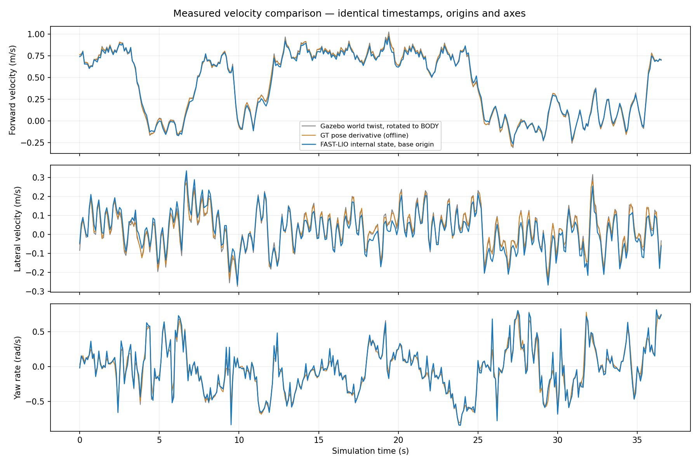
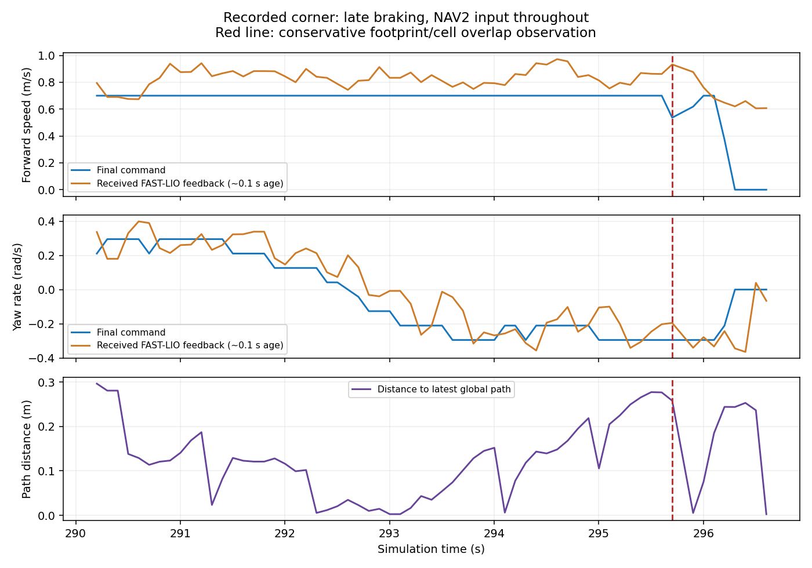

# 06. Navigation·global planning 검증 보고서 색인

[문서 처음으로](README.md)

아래 HTML은 실험 당시의 스냅샷이다. 과거 값(footprint .70×.65m, clearance .45m, filter −.35m 등)을 현재 권장값으로 읽지 않는다. 현재 설정은 [기준표](README.md), 구현은 연결된 소스가 기준이다. 브라우저로 보려면 저장소를 clone한 뒤 HTML을 열면 된다. GitHub 웹에서는 HTML 소스가 표시되므로 이 Markdown 요약과 PNG를 함께 사용한다.

## 핵심 결과

| 주제 | 확인한 근거 | 해석의 한계 |
|---|---|---|
| 전방 근거리 필터 | ±60° 방향과 센서 회전·point fields·stamp 보존 검사; 별도 1.0/1.5m trial | 모든 gait 자가 반사 제거를 보장하지 않음 |
| 단차 오검출 | 하한 −.20m 적용 시 기록된 9cm 표면 809점 제거, 큐브 61,474점 유지 | 지면-relative 15cm 분류 검증 아님 |
| 지도 일치 | v3 저장 height 원본 hash 일치, 상대 단차 검토 | 현재 localization·실물 배포 인증 아님 |
| native velocity | 자동 주행 vx RMSE .02357m/s, yaw .03438rad/s, age p95 .102s | 경로 추종/완주율을 직접 보장하지 않음 |
| DWB 코너 | 빠른 전진과 작은 yaw, 이후 무효 궤적/정지 관찰 | 수신 지연이 있으며 직접 contact/critic 계측 아님 |
| RPP | 공식 plugin 선택·파라미터·native velocity 연결 구성 확인 | 동일 조건 반복 완주 A/B 결과는 아직 없음 |
| Jetson | 계산 구조·불필요한 대형 알고리즘 추가 여부 검토 | Orin NX 실행시간·전력 실측 없음 |

## 보고서 목록

### 추종·stuck·전역 계획

| 기록 | 내용 |
|---|---|
| [tracking 2026-10-19](reports/tracking_20261019/report.html) | 초기 추종·속도·장애물 입력 관찰. 별도 cmd publisher의 영향과 분리해서 해석 |
| [stuck 2026-10-19](reports/stuck_20261019/report.html) | 추종기·watchdog·경로 입력으로 정지 계층 구분 |
| [narrow 2026-10-20](reports/narrow_20261020/report.html) | 좁은 통로와 footprint/obstacle 판정 검토 |
| [stuck gate 2026-10-20](reports/stuck_gate_20261020/report.html) | planner gate·floor leak·높이/정합 관련 분석 |
| [cube DWB 2026-10-27](reports/cube_dwb_20261027/report.html) | 큐브 추가 후 planner 실패와 상단 의심 장애물 원인 분석 |
| [yaw abort 2026-10-27](reports/yaw_abort_20261027/report.html) | yaw 변환·rollout 실패·FollowPath/BT 중단 분석 |
| [east stuck 2026-10-27](reports/east_stuck_20261027/report.html) | 동쪽 통로 반복 정지, clearance/pose velocity 당시 실험 |
| [turn choice 2026-10-27](reports/turn_choice_20261027/report.html) | 좌/우 회전 후보와 경로·critic 선택 문제 |

### 센서·필터·시간

| 기록 | 내용 |
|---|---|
| [self returns 2026-10-20](reports/self_returns_20261020/report.html) | 몸체 외곽·자가 반사 의심점·map 정합 검토 |
| [range trial 2026-10-27](reports/range_trial_20261027/report.html) | 전방 .3m, 측후방 1/1.5m 별도 패키지 시험 |
| [sector comparison JSON](reports/front_sector_20261020/sector_comparison.json) | 전방 각도별 비교 기록 |
| [filter microbenchmark](reports/front_sector_20261020/bench.txt) | PC에서 순수 범위 판정 loop 비교; DDS·TF·ROS callback 전체 비용 아님 |
| [height band offline](reports/height_band_20261027/offline_check.json) · [live](reports/height_band_20261027/live_check.json) | BODY 높이 하한을 −.20m로 올린 비교 |
| [LIO time 2026-10-20](reports/lio_time_20261020/report.html) | sim time·message filter·TF 시간 문제 |
| [Gazebo crash 2026-10-27](reports/sim_crash_20261027/report.html) | 외부 Livox simulator index overflow 분석 |

### 속도 피드백·감속

| 기록 | 내용 |
|---|---|
| [FAST-LIO velocity / GT](reports/fastlio_velocity_20261027/report.html) | native 속도 추정·time alignment·저속 전진/후진/yaw 시험 |
| [DWB live 연결](reports/fastlio_velocity_20261027/dwb_live_report.html) | production 입력 검증과 측방향 rollout 모델 검토 |
| [corner braking](reports/fastlio_velocity_20261027/corner_braking.html) | 코너 감속 부족 기록, RPP 비교 프로필 준비 |
| [연결 검사 JSON](reports/fastlio_velocity_20261027/check_connection.json) | 격리 domain184에서 source 선택·offset·stamp·stale 거부 검사 |
| [자동 주행 오차 수치](reports/fastlio_velocity_20261027/dwb_live_samples_analysis.json) | 366개 time-aligned 표본의 GT 비교 |

### 지도·외곽·설정 적용

| 기록 | 내용 |
|---|---|
| [v3 site README/QC](../../maps/cost_wall_lower10_v3/README.md) | 원본 height 출처·PCD 재사용·정합 한계 |
| [site bundle 검사](reports/site_lower10_v3_20261027/bundle_check.json) | hash와 지도 선택 검사 |
| [모델 footprint 비교](reports/footprint_model_20261027/comparison.json) · [그림](reports/footprint_model_20261027/comparison.png) | 현재 pose 및 과거40개 pose 외곽, 전체 gait 검증 아님 |
| [추가 clearance 제거 검사](reports/clearance_off_20261027/launch_results.json) | trial planner 0m 설정과 launch 조립 |
| [inflation 당시 런타임](reports/inflation_20261027/runtime.json) | 변경 당시 적용값; 현재 기준과 다를 수 있음 |

초기 설계·height mapping·오프라인 지도 처리 배경은 [전체 기술 보고서](../REPORT.md), [지도 후처리 보고서](../../validation/postprocess/report.html), [height mapping 이력](../mapping_history/VALIDATION.md)에 있다. 이들 역시 작성 당시의 범위를 따른다.

## 결과를 과장하지 않기 위한 기준

- 실험마다 map, controller, footprint, filter가 바뀌었다. 서로 다른 run의 p95만 비교해 개선율을 주장하지 않는다.
- `dwb_tracking_comparison.png`의 기록에는 서로 다른 주행 조건/입력 전환 구간이 포함된다. 순수 자동 주행의 동일 조건 A/B로 쓰지 않는다.
- conservative costmap overlap은 Gazebo 물리 접촉과 동일하지 않고 DWB 내부 critic의 동일 구현도 아니다.
- HTML/JSON의 `recorded_not_yet_accepted` 같은 상태는 생성 시점의 기록이다. 이후 연결 검증과 분리해 읽는다.
- 보고서 속 “기존 파일 변경 없음”은 그 실험 턴의 변경 범위다. 이 인계 브랜치 전체가 최초 main 대비 무변경이라는 뜻이 아니다.

## 원시 데이터와 재현 범위

15개 HTML, 연결된 도식·작은 JSON·설정·분석 소스를 선별해 보관했다. HTML은 현재 문서 링크·안내 배너만 추가했고 실험 수치는 바꾸지 않았다. [manifest](reports/manifest.json)에 원본과 배포본 hash가 있어 provenance를 확인할 수 있다.

대형 point cloud/시계열 dump와 전체 before 디렉터리까지 복제한 완전한 데이터셋은 아니다. 전체 재분석에는 해당 장비의 `validation/<run>/` 원본이 필요하다. [로컬 원본 안내](reports/LOCAL_DATA.md)
